# 0001 · Visual direction: The Dad-a-base

Milestone 1. The site gets its look, a name and a design system. Over four rounds of throwaway prototypes, the author chose "Sunday funnies": a newspaper comics page with a blackletter masthead, a dad peeking over his paper as its crest, Oswald headlines and newsprint colours. The site is renamed **The Dad-a-base**. The direction is built as tokens in three layers, with a `/design-system` page that reads them from the stylesheets, and Storybook served at `/storybook`.

## The rounds

The prototypes were single HTML files in the scratchpad, switched with a floating bar, each showing home, a joke page and the 404 in light and dark. They're kept on the `prototype/visual-direction` branch.

| Round           | Options                                                                                                             | The author's choice                                                              |
| --------------- | ------------------------------------------------------------------------------------------------------------------- | -------------------------------------------------------------------------------- |
| 1. Direction    | A retro database terminal; a 70s dad den; a comic zine                                                              | **The comic zine,** "toned down a bit"                                           |
| 2. Calmer zines | Tidy zine; Sunday funnies (a newspaper comics page); Dad says (a cartoon dad in speech bubbles)                     | **Sunday funnies,** renamed Dad-a-base, with a new logo font and an illustration |
| 3. Masthead     | Blackletter with the dad as a crest; a heavy slab with the dad above; comic caps with the dad peeking over the name | **Blackletter crest**, with a different font for headings                        |
| 4. Headings     | Playfair Display; Oswald; Libre Franklin                                                                            | **Oswald**                                                                       |

| Round            | Screens                                                    |
| ---------------- | ---------------------------------------------------------- |
| 1, home, light   | 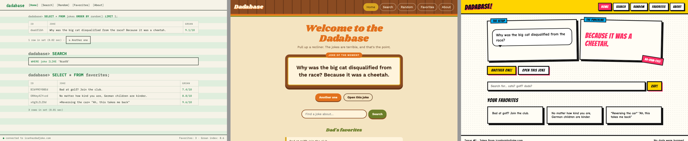          |
| 1, the 404, dark | 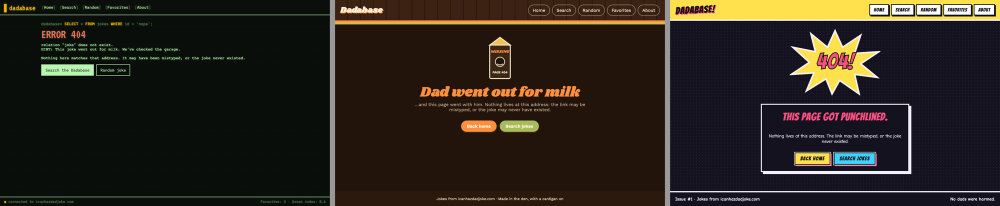 |
| 2, home, light   | 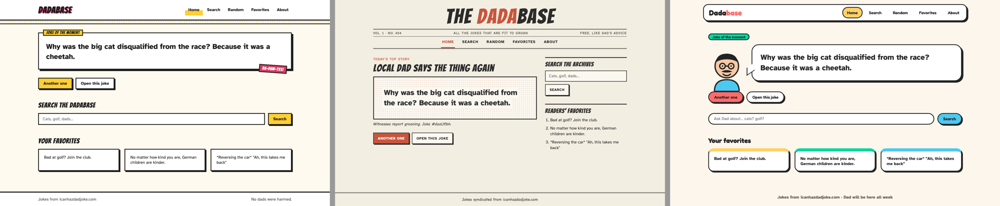     |
| 3, mastheads     | 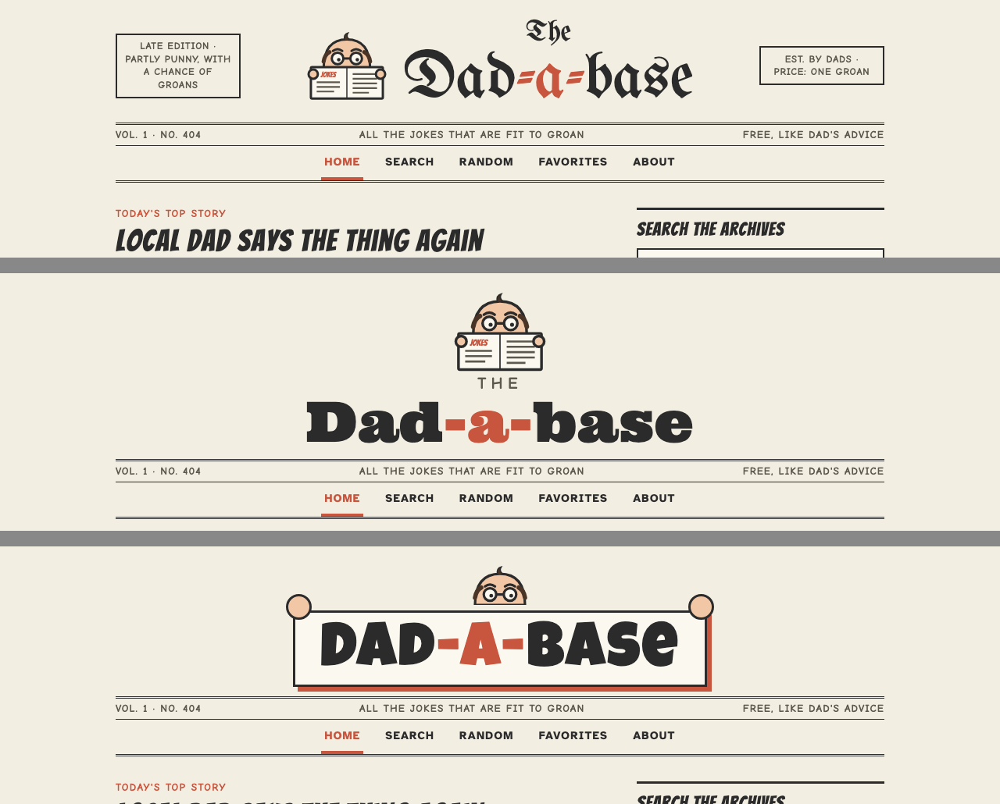           |
| 4, heading fonts | 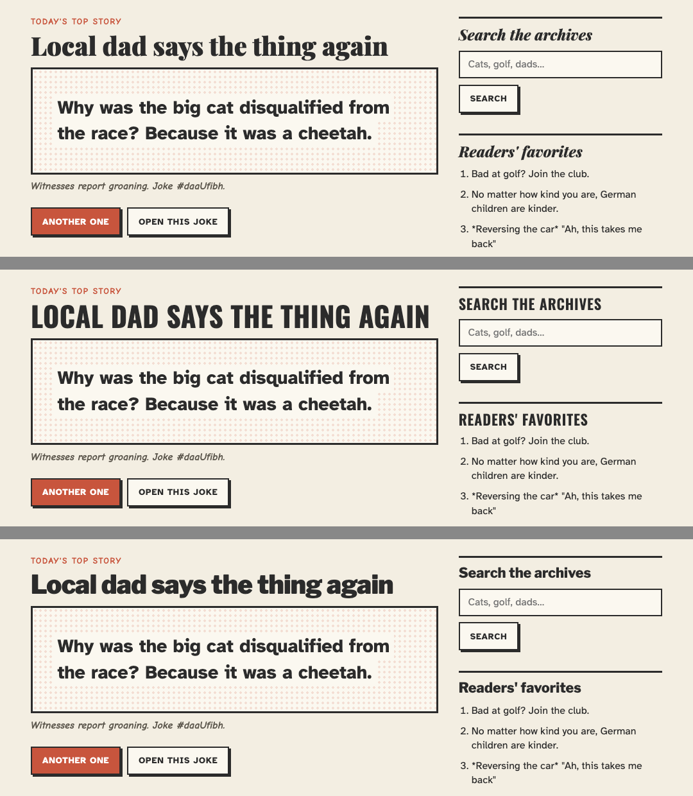       |

## After

| Screen                 | Light                                                            | Dark                                                            |
| ---------------------- | ---------------------------------------------------------------- | --------------------------------------------------------------- |
| A random joke, desktop | 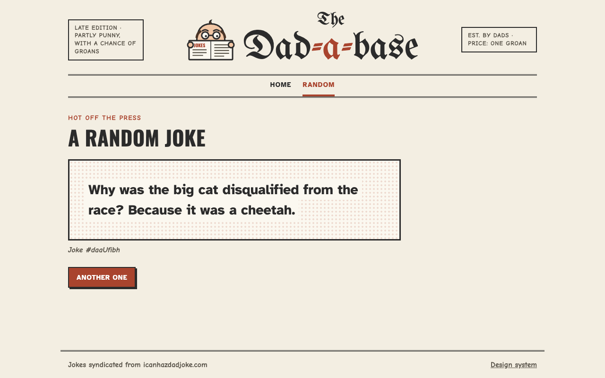        | 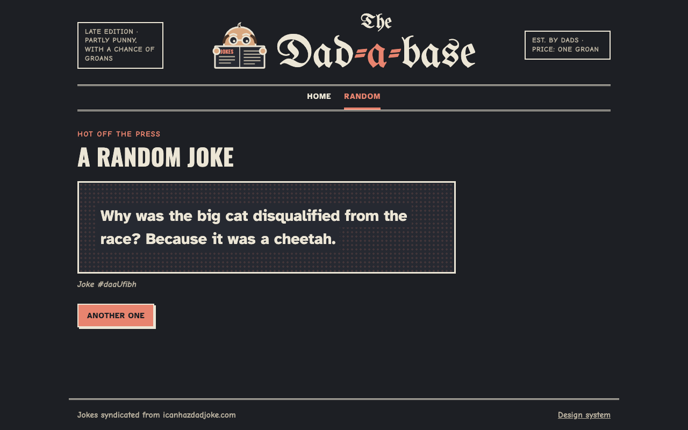        |
| A random joke, phone   | 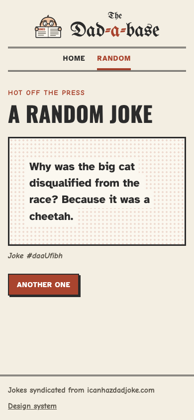          | 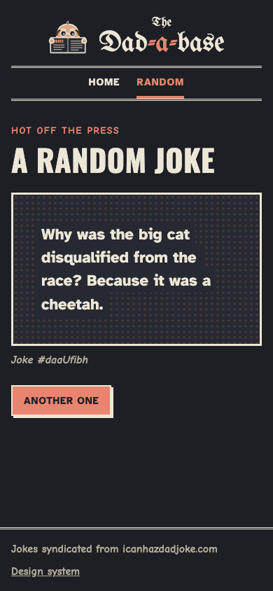          |
| Design system, desktop | 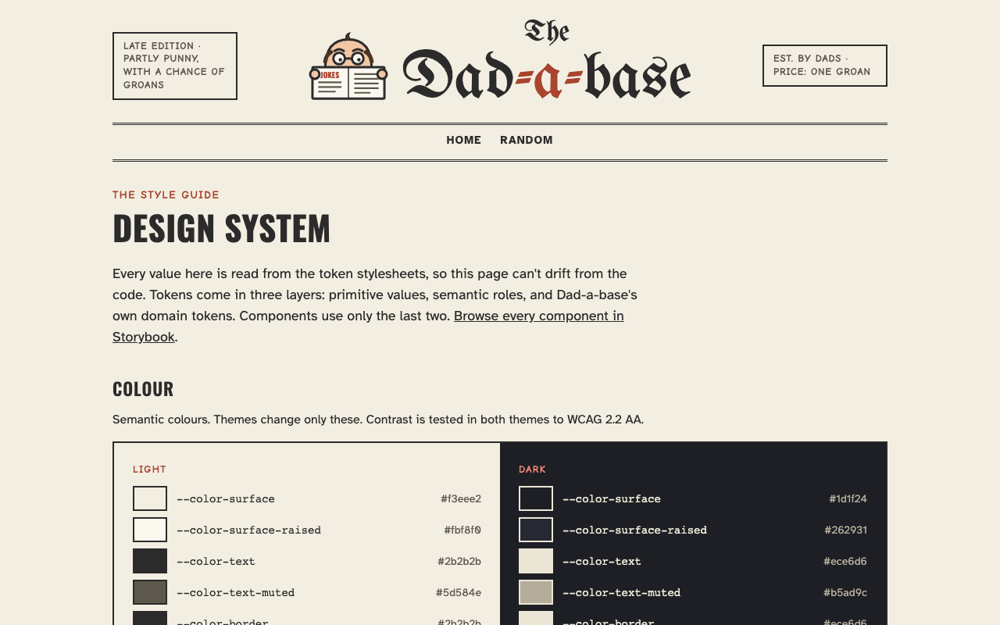 | 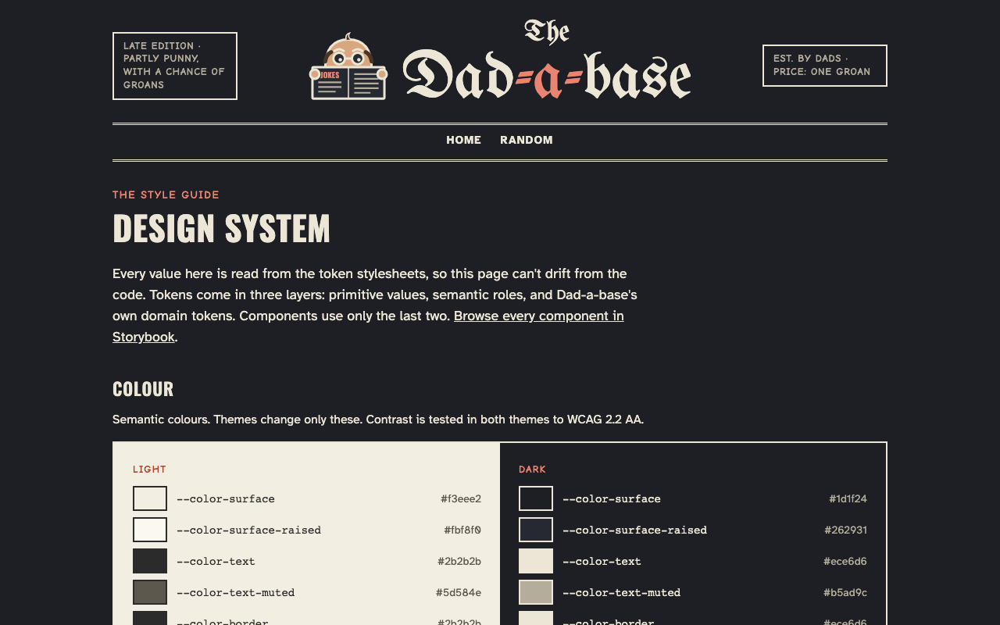 |
| Design system, phone   | 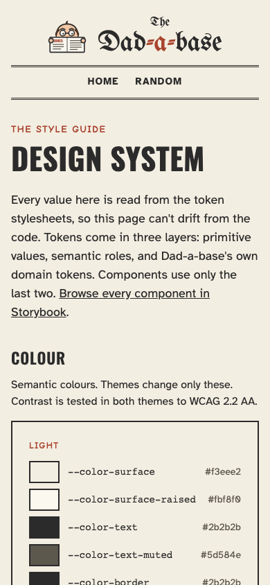   | 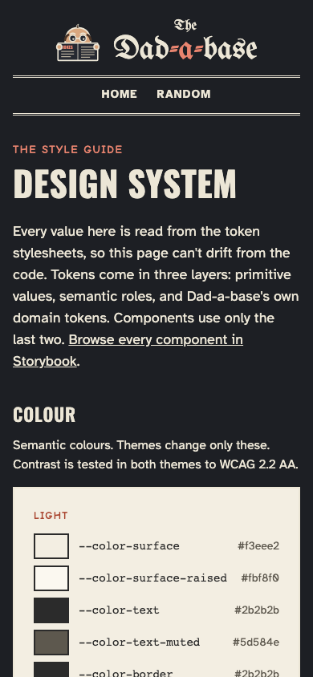   |

## Decisions

The author chose each of these from options.

- **Sunday funnies.** A newspaper's comics page: a masthead, a dateline, double rules, kickers above headlines, and each Joke in a halftone comic frame with a caption. The copy borrows the paper's voice: "All the jokes that are fit to groan", "The Dad-a-base regrets the error".
- **The name is The Dad-a-base,** in prose and on screen. In code it stays `dadabase` (the package name, for example).
- **The masthead.** "The Dad-a-base" in UnifrakturMaguntia, a blackletter, with "-a-" in red. The crest is the dad: bald, glasses, raised eyebrows, peeking over a paper headlined "JOKES". Two boxes flank it in the corners like a newspaper's ears: "Late edition · Partly punny, with a chance of groans" and "Est. by dads · Price: one groan".
- **Type.** Oswald for headlines, in caps. Comic Neue for kickers and captions. Atkinson Hyperlegible, a font designed for legibility, for everything else, the Jokes included.
- **No groan rating.** Every round-1 prototype showed a "groan 9.1/10" score, but the API has none. It would have to be invented, so it's dropped.
- **The punchline reveal waits for milestone 8.** The comic zine split each Joke into a setup panel and a punchline panel. It needs a rule for Jokes with no clear break, so it's a polish item.
- **The address is <https://the-dad-a-base.vercel.app>.** `dad-a-base.vercel.app` belongs to someone else's "Dad-a-Base: Dad Joke Generator". The new domain is on the same Vercel project, so `vercel --prod` keeps it current. `dadabase-jade.vercel.app` still works.

Defaults, not asked:

- **The red is darker than the prototype's.** `#c8553d` measured 3.76:1 as text on the page and 4.35:1 under white button text, below WCAG AA's 4.5:1. `#a9442e` gives 5.1:1 and 5.9:1 and looks almost the same.
- **Fonts are self-hosted** from Fontsource, Latin subset only, so the site makes no requests to Google.
- **The masthead sizes itself to its container,** not the viewport (`cqi` units and a container query). It fits a half-width panel on `/design-system`, and the corner boxes go below 48rem of its own width.

## The design system

- **Three layers** (ADR 0004):
  - **Primitives:** newsprint, night, the dad's skin and hair; four font stacks; a type scale; steps of space; line widths.
  - **Semantic tokens:** colours per theme, plus shared tokens for fonts, sizes, `--space-1` to `--space-8`, borders, shadows and target size.
  - **Domain tokens:** the masthead, headlines, kickers, captions, the joke frame and its halftone, buttons, the correction notice, and the dad.
- **Themes** follow the system for now. `data-theme` on the root (from milestone 2's toggle) or on any element overrides it.
- **`/design-system`** shows the semantic colours in both themes side by side with their values, type specimens, the space scale, the components in both themes, and every domain token. It reads them all from the stylesheets (`?raw` imports parsed by `tokens.ts`), so it can't drift from the code.
- **Components:**
  - `SiteMasthead`;
  - `DadIllustration`;
  - `AppButton`, with a printed offset shadow that presses in, and doesn't move under reduced motion;
  - `JokeCard`, the comic frame where each line of text sits on its own paper backing, so the halftone never sits behind the words;
  - `StoryHeading`, a kicker and a headline;
  - `ThemeSpread`, which renders its slot in both themes.
- **Storybook at `/storybook`.** `npm run build:site` builds it into `dist/storybook`. Vercel serves it beside the app, outside the app's rewrite, with `X-Robots-Tag: noindex`.

## Problems found on the way

- **Domain tokens kept the light theme inside a dark panel.** A custom property's `var()` resolves where it's declared. Declared on `:root`, `--kicker-color` was fixed to the light red, and a `[data-theme='dark']` panel inherited it. axe failed `ThemeSpread`'s story on contrast. Domain tokens are now declared on `:root` and on every `[data-theme]`. Without that, milestone 2's toggle would have hit the same bug.
- **Components used primitives.** The new test for ADR 0004's rule found every component using the spacing primitives. Spacing steps became semantic tokens over primitive `--step-*`. Three domain tokens also skipped the semantic layer (the fluid sizes and a line width); they now go through semantic tokens.
- **`?raw` CSS was empty in Vitest.** Vitest empties CSS imports by default. The unit project now processes `src/styles/tokens/*.css`.
- **Coverage missed components tested only in Storybook.** Coverage now runs the unit and Storybook projects together, with one gate.
- **Two landmarks shared a name** on `/design-system`: the domain-token section and its scrollable table. axe caught it, and the table's region has its own name now.

## Tests

- **Vitest:**
  - the token layers parse, and dark mode is identical by system setting and by `data-theme`;
  - every semantic colour exists in both themes;
  - semantic tokens use only primitives, domain tokens use only semantic tokens, and no component stylesheet uses a primitive;
  - every token resolves in both themes;
  - **contrast in both themes:** text and muted text on both surfaces, accent text on both surfaces, and text on the accent at 4.5:1 or more; borders and the focus ring at 3:1 or more;
  - `DesignSystemView` shows every colour in both themes with its value, every space step and every domain token, and links to Storybook.
- **Storybook:** stories with `play` tests for every new component, axe as an error in each. The masthead's narrow story checks that the corner boxes go below 48rem.
- **Playwright,** on desktop Chromium, mobile WebKit and mobile Chrome:
  - axe on `/`, `/random` and `/design-system` in light and in dark;
  - the page follows the system scheme;
  - `/design-system`'s panels keep their own themes whatever the page's;
  - each route reflows at 320px with no sideways scrolling;
  - the masthead links home.
- **Totals:**
  - Vitest and Storybook: 72 passed, 99% of statements and 95% of branches (the gate is 90%).
  - Playwright: 42 passed.

## Open

- **The rough shell.** Milestone 2 replaces it with the dateline, skip links, the theme toggle, full navigation and `ErrorView`. The footer's rule runs wider than the header's rules.
- **The VoiceOver pass** waits for milestone 2's shell, as for milestone 0.
- **The author reviews the copy:** the ears, the kickers ("Today's top story", "Hot off the press") and "Local dad says the thing again".
