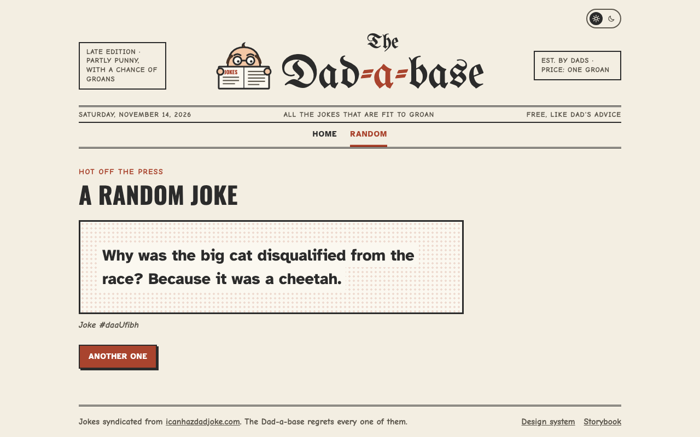
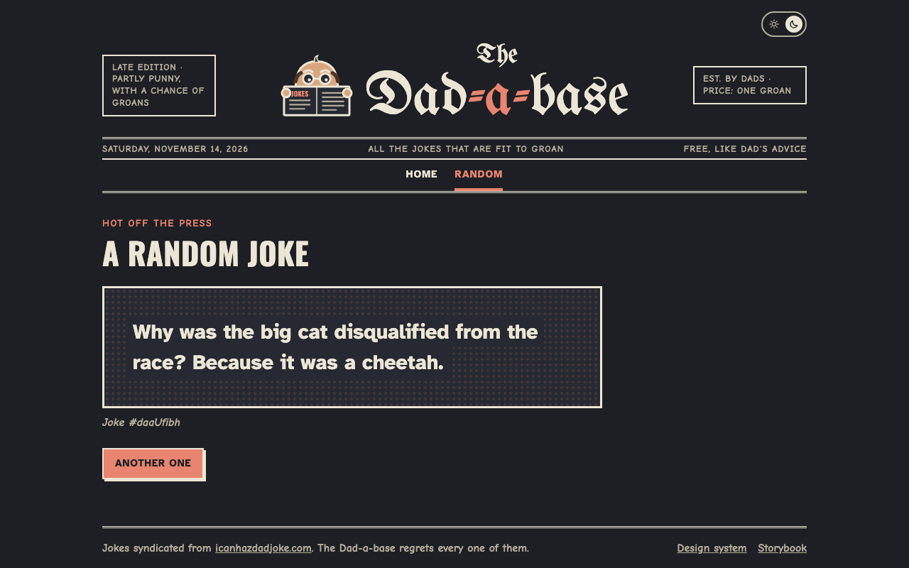
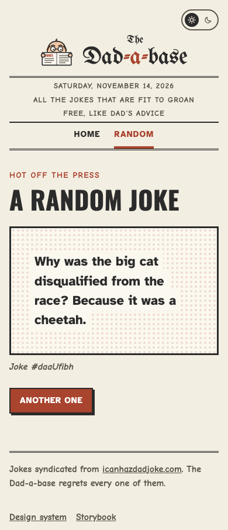
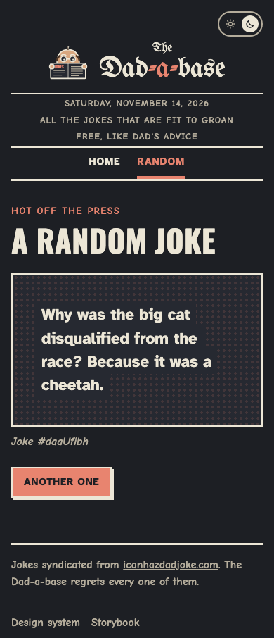
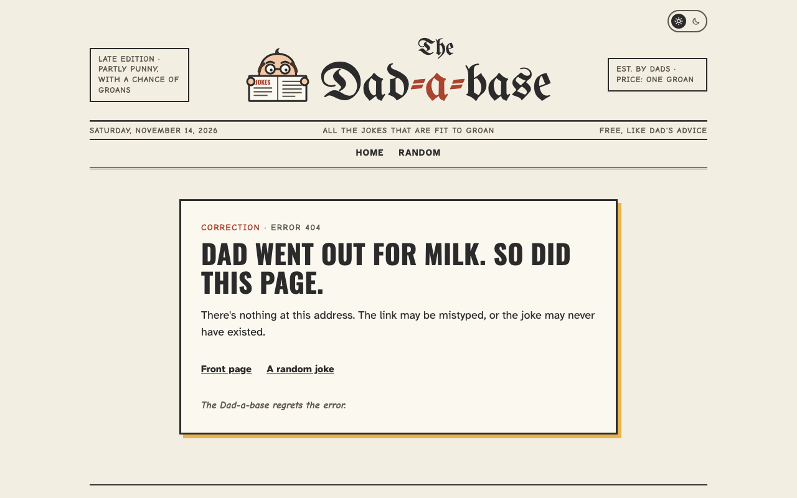
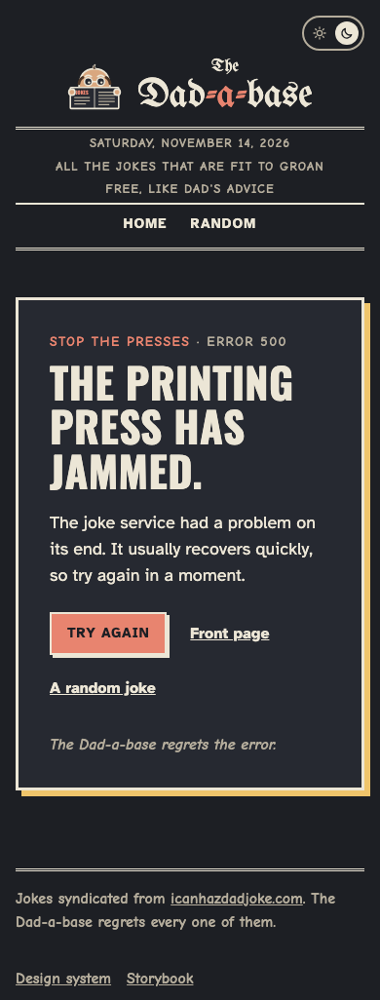
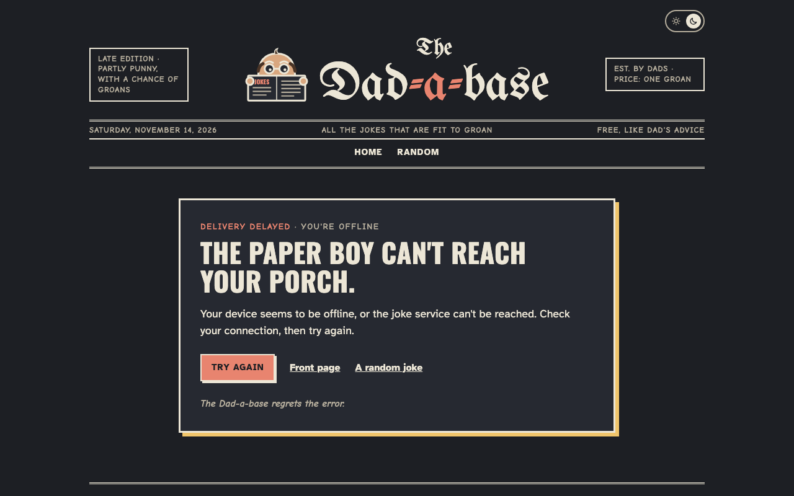
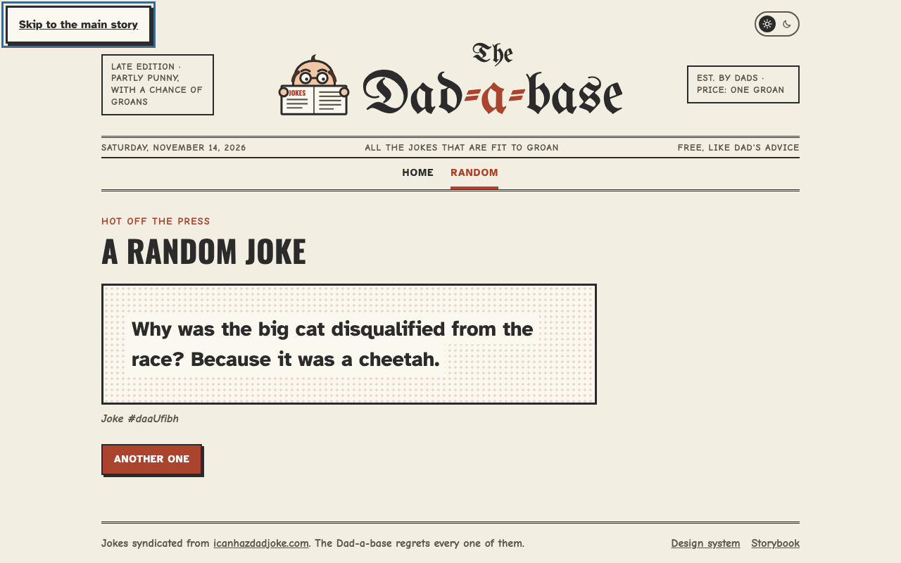

# 0002 · The app shell

Milestone 2. Every page now sits in the paper's full shell:

- **Header:** a skip link, the theme toggle, the Masthead, a dateline with today's date, and the main navigation.
- **Footer:** a credit and a colophon.
- **`ErrorView`** covers every Error state, at its own address and in place.

When the API fails, the page becomes a correction notice with a "Try again" that works. Any address the site doesn't know shows the 404 without changing the address.

## After

| Screen                            | Light                                              | Dark                                               |
| --------------------------------- | -------------------------------------------------- | -------------------------------------------------- |
| A random joke, desktop            |  |   |
| A random joke, phone              |    |     |
| An unknown address (404), desktop |     |                                                    |
| The server error (500), phone     |                                                    |        |
| Offline, desktop                  |                                                    |  |
| The skip link, focused            |     |                                                    |

## Decisions

Defaults, not asked: the author said "build milestone 2".

- **Errors replace the page, in place.** On `/random`, a failed fetch swaps the whole page for `ErrorView`, so there's one `h1`, and "Try again" refetches. The address never changes. `/error/:code` also exists for every code, so Storybook, Playwright and the Case Study can link to each one; there, "Try again" reloads. An unknown code is a 404, and so is any unknown address.
- **Each Error state follows the voice guide** ([`voice.md`](../voice.md)):
  - a kicker and a pun headline;
  - a plain explanation of what happened and what to do;
  - "Try again" only where it could help (429, 500, offline and unknown);
  - always "Front page" and "A random joke";
  - "The Dad-a-base regrets the error" at the foot.

  The kicker also names the code ("Correction · Error 404"), so the error is never only a joke.

  | Code    | Kicker           | Headline                                 |
  | ------- | ---------------- | ---------------------------------------- |
  | 404     | Correction       | Dad went out for milk. So did this page. |
  | 403     | Members only     | Sorry, this is a lodge meeting.          |
  | 429     | Slow news day    | Easy, tiger. Even Dad needs a breather.  |
  | 500     | Stop the presses | The printing press has jammed.           |
  | offline | Delivery delayed | The paper boy can't reach your porch.    |
  | unknown | Errata           | Well, that wasn't in the script.         |

- **The theme toggle is a small sun-and-moon switch,** at the author's request after reviewing the preview. It went through three versions:
  1. A labelled radio group, "Theme: Auto · Light · Dark".
  2. One icon, showing what pressing it would do. The author asked for no Auto, icons instead of words, and something more subtle.
  3. Both icons in a pill, with a thumb behind the one in use. The author found a lone icon ambiguous.

  The switch is drawn small and muted inside a full 44px target. The thumb slides, or jumps under reduced motion.
  - It's a toggle button: its name is always "Dark theme", and `aria-pressed` says whether dark is on. The voice guide keeps puns out of controls' names, so it isn't "Night edition".
  - Until the visitor presses it, the page follows the system, and keeps following it as the system changes. Pressing it saves a choice in localStorage. With no Auto, there's no way back to following the system short of clearing site data; the author accepted that.
  - An inline script in `index.html` applies the saved theme before the first paint. A test checks that it uses the store's key.
  - If storage is blocked, the theme still applies; it just isn't remembered.

- **Focus follows navigation.** After every navigation but the first, focus moves to the new page's `h1`, as on a page load. The skip link ("Skip to the main story") is the first stop on the page and moves focus to `main`.
- **The main navigation lists only built pages:** Home and Random for now. Search, Favorites and About join as their milestones land (`src/navigation.ts`), so nothing links to a stub.
- **The dateline shows today's date,** with "All the jokes that are fit to groan" and "Free, like Dad's advice".
- **The footer credits icanhazdadjoke and links the colophon:** the design system and Storybook. There's no link to the code yet: the repo is internal to onX, so the public would get a 404.
- **CI's actions are on v7** (`checkout`, `setup-node`, `upload-artifact`), clearing GitHub's Node 20 deprecation notice.

## Problems found on the way

- **Safari words a failed fetch differently.** Chrome says "Failed to fetch", Firefox "NetworkError…", Safari "Load failed". The offline check matched only the first two, so Safari would have shown `unknown`. It matches all three now, each with a test.
- **MSW's simulated network error reads differently on WebKit:** "Response served by service worker is an error". So the offline end-to-end test skips WebKit, and the unit test covers Safari's real wording. The other failures (503, 429) run on all three browsers.
- **Playwright can't reach MSW's handlers inside the page.** A test sets `dadabase:mock-failure` in sessionStorage to a status or `offline`, and the mocked API answers with it until it's cleared.
- **Storybook needed Pinia and a head manager,** now in its preview, and both are pre-bundled with vue-router so a cold run doesn't reload mid-way, as in milestone 0.

## Tests

- **Vitest:**
  - the voice guide for every Error state: all four parts present, a full-sentence explanation that differs from the headline, no exclamation marks, and "Try again" only on 429, 500, offline and unknown;
  - the theme store: auto by default, a saved choice, an unknown value ignored, saving and forgetting, blocked storage, and the key shared with `index.html`;
  - the App: home to random with focus on the new `h1`, the skip link, both navigations, a 404 in place keeping the address, `/error/429`, `/error/offline` and `/error/999`, and "Try again" reloading;
  - `RandomView`: a 503 shows the Error state and recovers on "Try again", and a 429 shows its own;
  - offline in every browser's wording.
- **Storybook:**
  - `ErrorView` for every code, with "Try again" calling back, absent where it can't help, and absent without a handler;
  - `ThemeToggle` by click and by Space, with `aria-pressed` following;
  - `SiteHeader` with a fixed date, and the skip link first;
  - `SiteFooter`.
- **Playwright,** on three browsers:
  - **theme:** following the system until toggled, then kept across a reload, and applied before any app code runs;
  - **skip link:** the first Tab reaches it, and it moves focus to `main`;
  - **navigation:** focus on the new headline, and the current page marked;
  - **a 404 in place:** the address kept, and "Front page" working;
  - **failures on `/random`:** a 503 recovering on "Try again", a 429, and offline;
  - **axe:** every `/error/:code` in light and dark, and `/error/500` and an unknown address in the reflow and axe sweeps.
- **Totals:**
  - Vitest and Storybook: 116 passed, 99% of statements and 94.5% of branches.
  - Playwright: 121 passed, 2 skipped. Safari tabs only to form fields by default, and MSW's offline error on WebKit is covered above.

## VoiceOver pass

**Status: passed.** The author ran this pass on 2026-11-14 on the preview deploy, and it cleared. It covered the first version of the theme control, a radio group. Its replacement, the toggle button, follows the standard pattern and is tested in Storybook and Playwright; milestone 3's pass covers it. On a Mac and an iPhone:

1. On `/random`, the first Tab (or swipe) reaches "Skip to the main story". It moves to the main story.
2. The theme control changes the theme. (Then a radio group, "Theme, group", with Auto, Light and Dark.)
3. The Masthead's link reads "The Dad-a-base". "Main" navigation lists Home and Random, with the current page announced.
4. Choosing Random from the navigation moves to its headline, "A random joke".
5. `/no/such/page` reads "Correction · Error 404", then the headline, the explanation, "Front page" and "A random joke".

## Open

- **No link to the code.** The repo is internal to onX, so neither the footer nor the Case Study links to it. The author removed the Case Study's planned "View the code on GitHub" button.
- **No real 404 status.** The site is a single-page app on static hosting, so an unknown address returns HTTP 200 with the 404 page. Search engines see a soft 404. It's fine for a demo; fixing it would need server-side routes.
