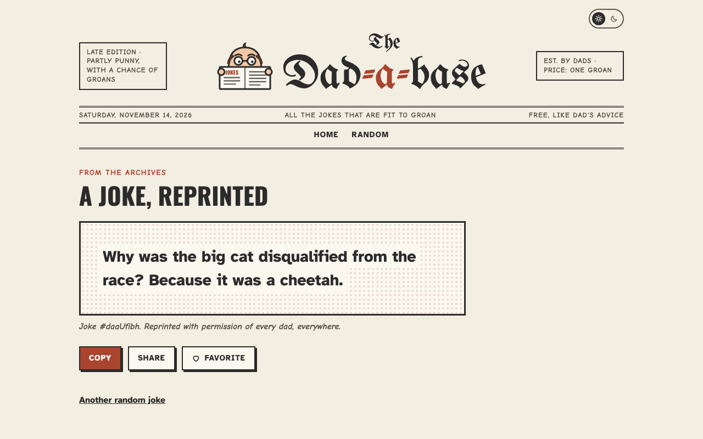
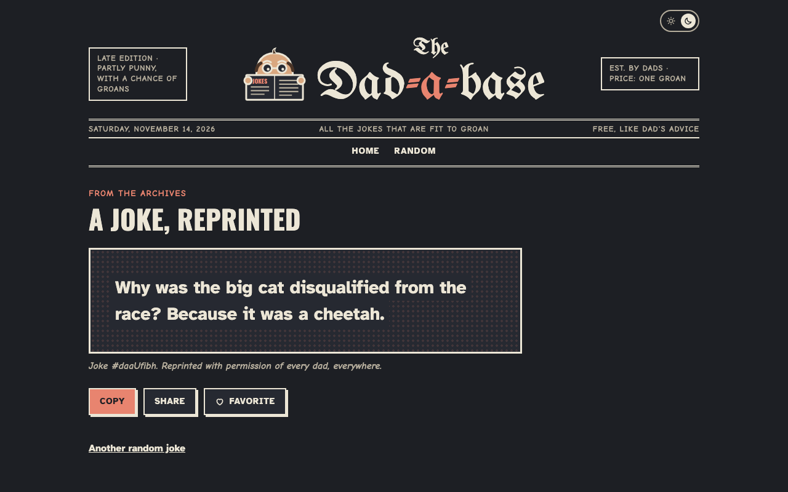
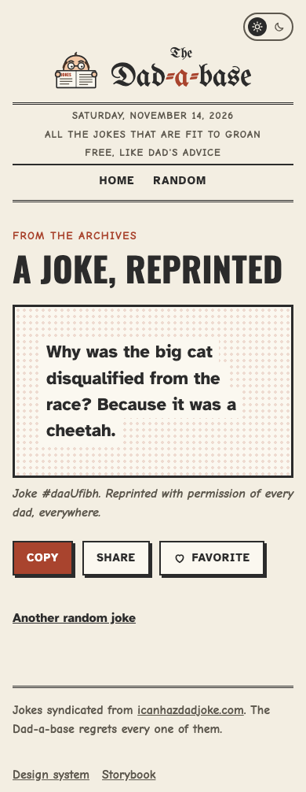
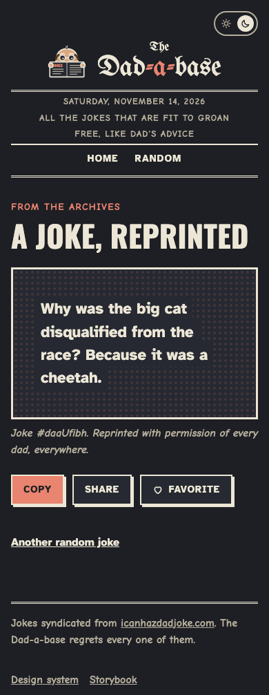
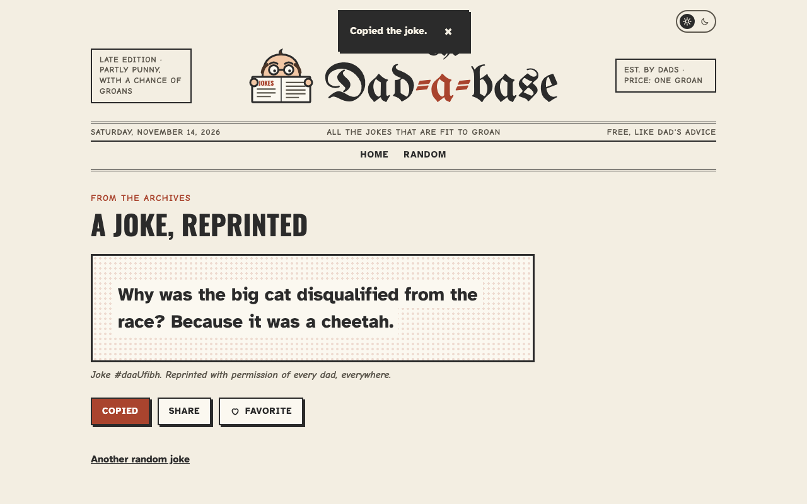
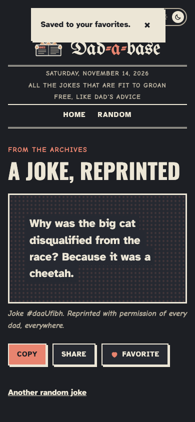
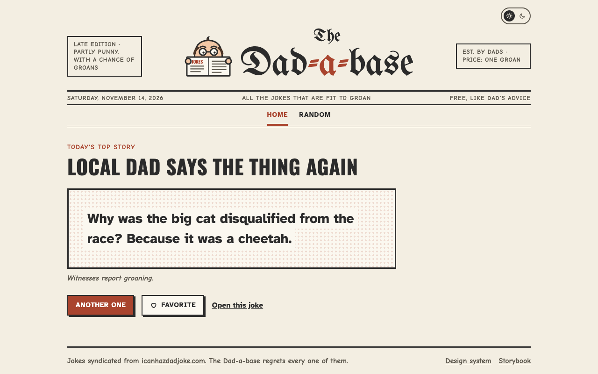
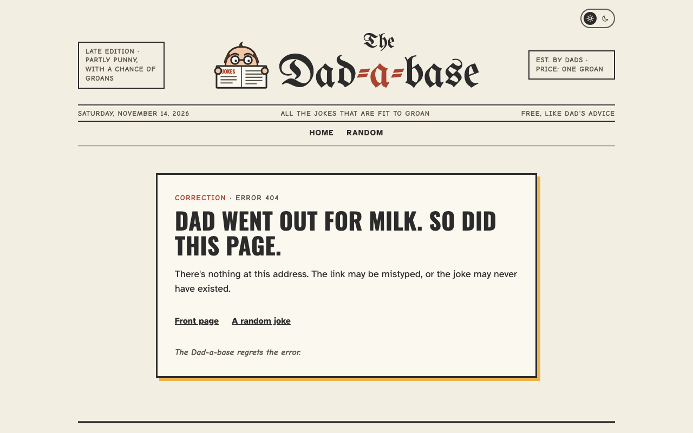

# 0003 · A Joke's own page

Milestone 3. Every Joke has a page at `/jokes/:id`, where the visitor can copy it, share it and save it as a Favorite. The random Joke links to its page and has its own Favorite toggle. The home page now leads with a Joke of the moment, as "Today's top story". Short confirmations come as toasts, which screen readers announce.

## After

| Screen                       | Light                                                      | Dark                                                 |
| ---------------------------- | ---------------------------------------------------------- | ---------------------------------------------------- |
| A Joke's page, desktop       |          |     |
| A Joke's page, phone         |            |       |
| Copied, desktop              |        |                                                      |
| Saved to Favorites, phone    |                                                            |  |
| Home, the Joke of the moment |          |                                                      |
| A Joke that doesn't exist    |  |                                                      |

## Decisions

Defaults, not asked: the author said "build milestone 3".

- **The page.** It has a kicker ("From the archives"), a headline ("A joke, reprinted"), the Joke in its frame, and three actions: Copy, Share and Favorite. Under them, a link to "Another random joke".
- **The id is in the caption, not the kicker.** The caption reads "Joke #daaUfibh. Reprinted with permission of every dad, everywhere." Kickers are set in capitals, and capitals turned `daaUfibh` into `DAAUFIBH`, a different id.
- **The title is the Joke's opening words,** cut at a whole word under 60 characters: "Why was the big cat disqualified from the race? Because…".
- **Opening a Joke you've seen needs no fetch.** A cache policy reads `joke(id)` as a reference to `Joke:id`. A Joke from the random page, and from search in milestone 4, opens at once. A test checks that no request is made.
- **An unknown Joke is the 404, in place.** The API answers it with HTTP 200 and `{"status":404}`. `parseResponse` turns that into the 404 Error state (journal 0000), and the address stays.
- **Copy.** On success, the button reads "Copied" for two seconds, and a toast says "Copied the joke.". If the clipboard is missing or denied, the Joke's text is selected, and the toast says how to copy it by hand, with the visitor's own shortcut: "press ⌘C to copy it" on Apple devices, Ctrl+C elsewhere.
- **Share.**
  - Where the browser has a share sheet (most phones, Safari), it shares the Joke's text and its page.
  - Closing the sheet without sharing is the visitor's choice, so nothing is said.
  - Without a sheet, or if it fails, it copies the page's link: "Copied the link to this joke.".
  - If that fails too, the toast points to the address bar.
- **Favorites.**
  - A toggle button named "Favorite", with `aria-pressed` and a heart that fills.
  - A toast confirms each change: "Saved to your favorites." or "Removed from your favorites.".
  - The Pinia store keeps whole Jokes, newest first, in localStorage, so milestone 5's Favorites page needs no API calls.
  - What's loaded is checked with Zod: bad data starts the list empty instead of breaking the page.
  - Tabs stay in step through the `storage` event.
- **Toasts appear at the top of the screen,** at the author's request, so on a phone they don't cover the foot of the page. One live region (`role="status"`) is always in the page, so screen readers are listening before a message arrives. Each toast stays five seconds, has a 44px "Dismiss" button, and drops in unless reduced motion is on.
- **Home and `/random` share one component,** `RandomJokeStory`, with their own kicker, headline and caption. Each offers "Another one", "Favorite" and "Open this joke".

## Problems found on the way

- **Title cut mid-word.** The first title cut was at 57 characters, which ended "…Because i…". It now cuts at the last whole word.
- **A Storybook run failed with a stale cache.** Vite had pre-bundled dependencies before `zod` reached the browser code (the Favorites store), and reloaded mid-run. A cold run, like CI's, passed. `zod` is pre-bundled now too.
- **Test-only gaps:**
  - jsdom has no `blockquote` role, so unit tests find a Joke by its text.
  - `TransitionGroup` leaves a comment node in an empty toast region, so "nothing was said" is checked by its text.

## Tests

- **Vitest:**
  - the Joke query: from the cache with no request, fetched when unseen, and a 404 sent as HTTP 200;
  - the Favorites store: adding newest first, saving, removing, dropping Apollo's `__typename`, loading, bad saved data, another tab's changes, and blocked storage;
  - the toasts store: order, expiry and dismissal;
  - sharing helpers: copying, a denied clipboard, no Clipboard API, the shortcut by platform, selecting text, and the share sheet (shared, closed, failing, absent or unable);
  - `JokeView`:
    - the Joke and its title, short and long;
    - Copy, with the label resetting;
    - Copy denied, so the Joke is selected and the shortcut shown;
    - Share copying the link, failing, and the sheet closed quietly;
    - Favorite on and off;
    - an unknown Joke's 404;
    - recovering on "Try again";
  - `RandomJokeStory`: "Open this joke" following the Joke, Favorite, and the Error states.
- **Storybook:** Copy and Copy denied; Share with a share sheet; Favorite by click and by keyboard; toasts shown and dismissed.
- **Playwright,** on three browsers:
  - the random Joke opening its page, with its title and focus on the headline;
  - a Joke's page from its address;
  - Copy, reading the real clipboard in Chromium;
  - Copy on every browser ending copied or selected;
  - Share copying the link in desktop Chromium;
  - a Favorite kept across a reload and shown on the random Joke;
  - an unknown Joke's 404 in place;
  - recovering from a 500;
  - axe and reflow at 320px on a Joke's page in both themes.
- **Totals:**
  - Vitest and Storybook: 160 passed, 99% of statements and 95% of branches.
  - Playwright: 148 passed, 5 skipped. Only Chromium lets a test grant and read the clipboard, only desktop Chromium is sure to have no share sheet, and there are milestone 2's two.

## VoiceOver pass

**Status: passed.** The author ran this pass on 2026-11-14 on the preview deploy, and it cleared, the theme toggle included. On a Mac and an iPhone:

1. The theme toggle (carried over from milestone 2) reads "Dark theme, toggle button", with its state. Pressing it changes the theme and the state.
2. On `/random`, "Open this joke" moves to the Joke's page, and focus lands on "A joke, reprinted".
3. The Joke reads, then its caption, "Joke #daaUfibh. Reprinted with permission…".
4. "Copy" is announced, then "Copied the joke." without moving focus.
5. "Favorite, toggle button, not pressed". Pressing it announces "Saved to your favorites." and the state changes to pressed.
6. On an iPhone, "Share" opens the share sheet. Closing it says nothing.
7. `/jokes/nope` reads the 404.

## Open

- **A toast covers the theme toggle on a phone** for up to five seconds, or until dismissed. Toasts moved to the top at the author's request, so they no longer cover the foot of the page.
