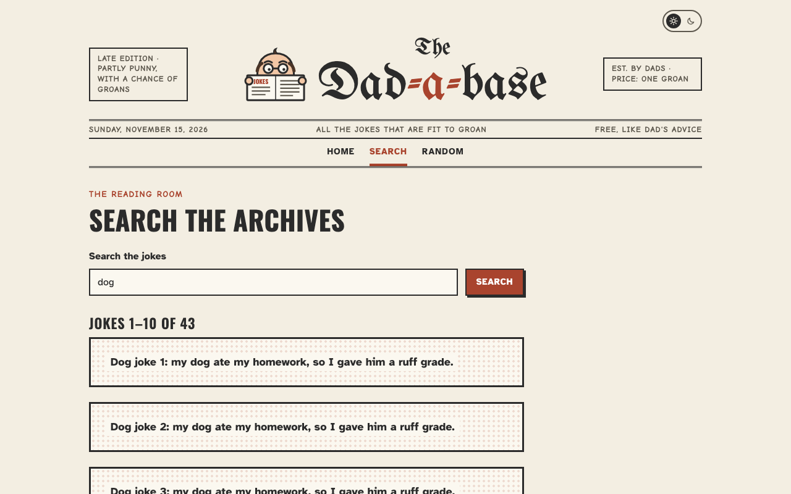
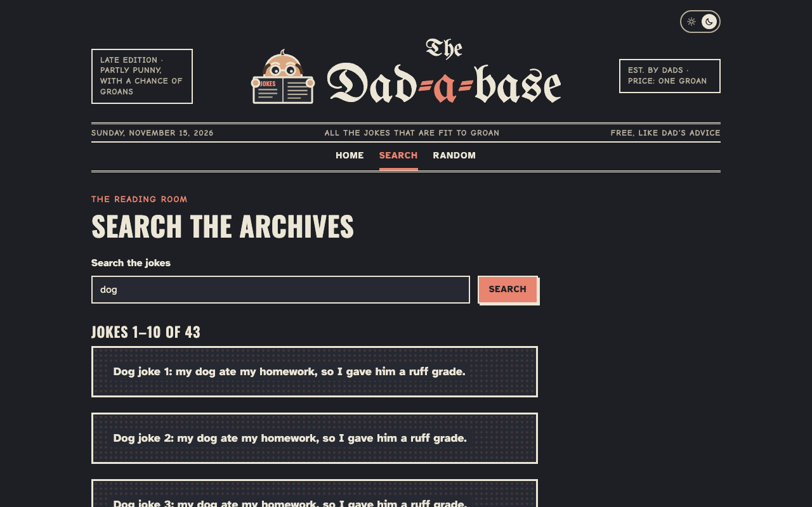
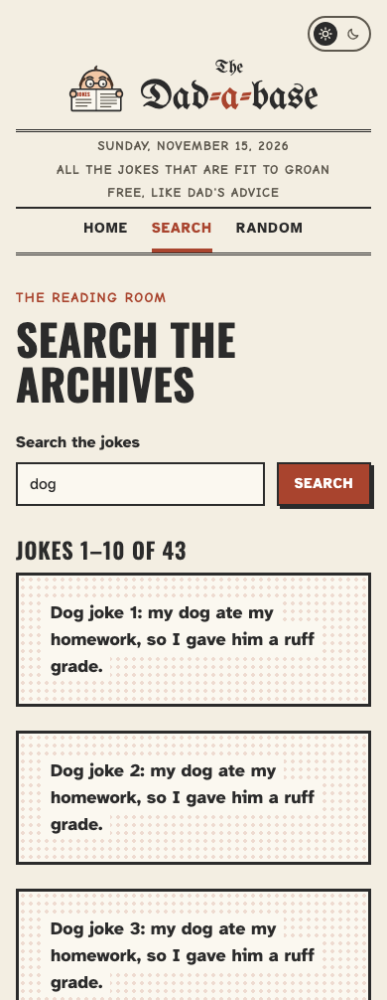
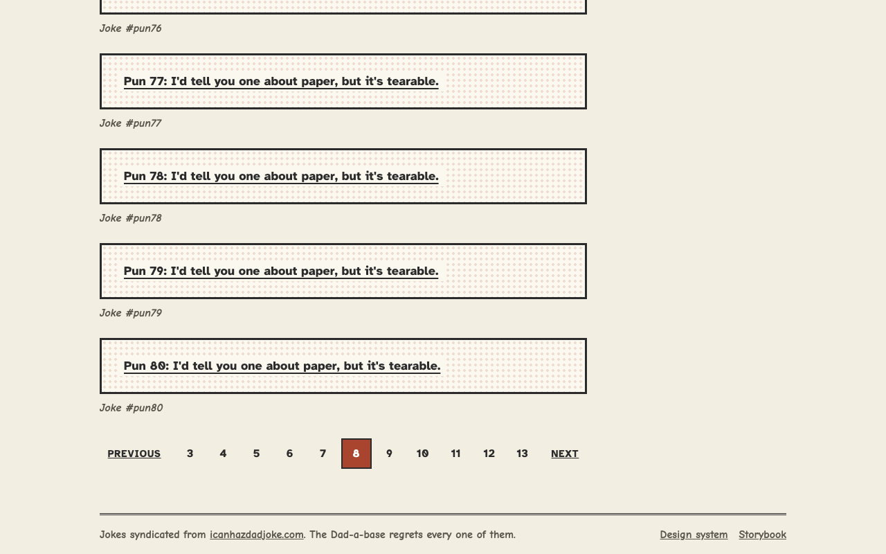
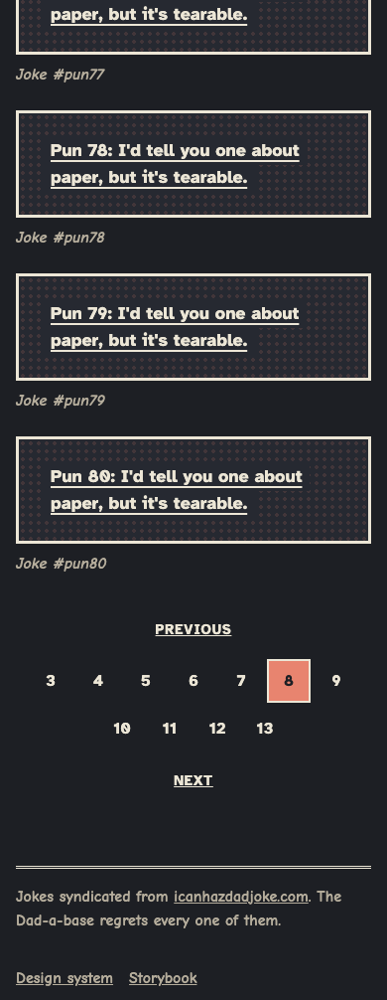
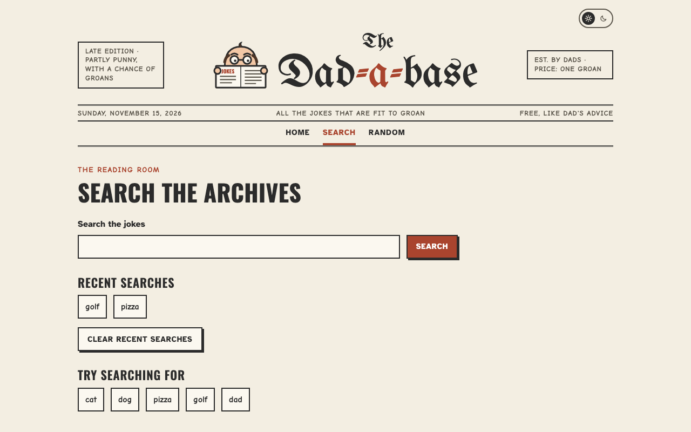
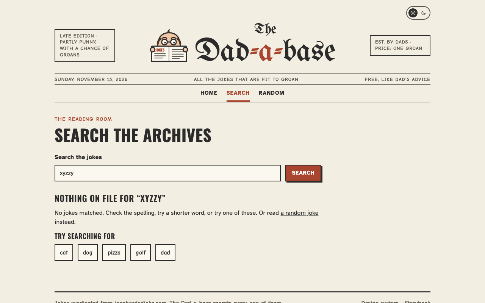
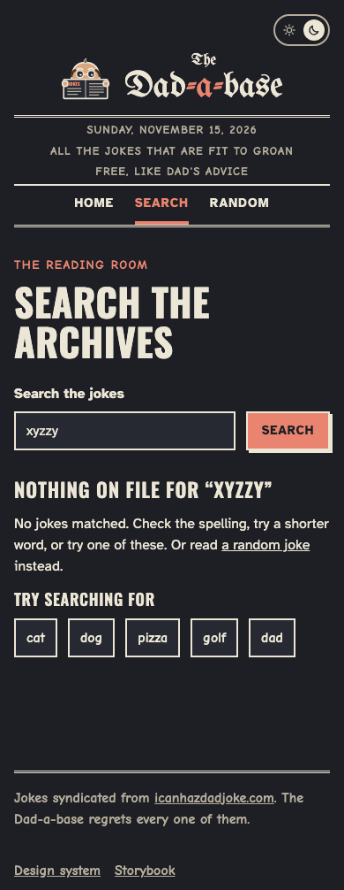
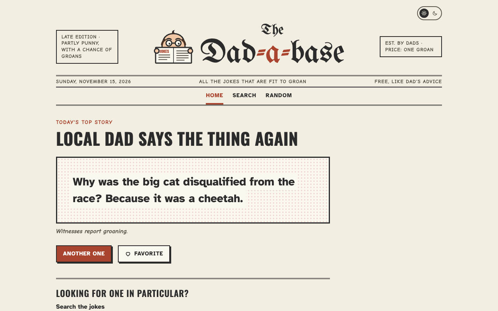
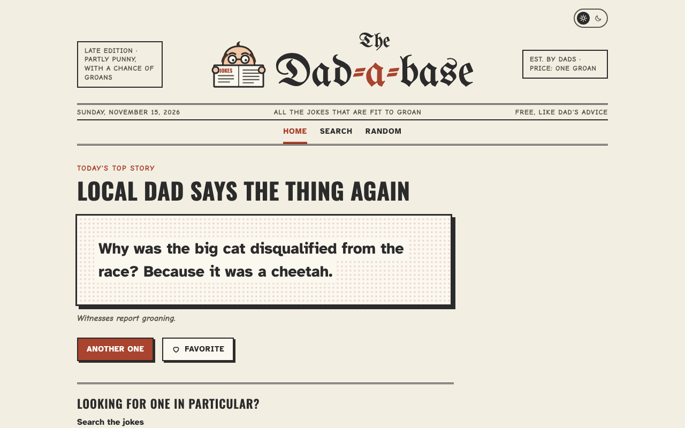

# 0004 · Search and pagination

Milestone 4. `/search` searches the archive as you type, ten Jokes a page, with the term and page in the URL. Results are Joke cards that open their page from the cache. An empty box offers recent and suggested searches, and a Search that finds nothing says so inline, with suggestions. Home has a search box, and the main navigation now lists Search. A Joke card that links now links as a whole, with no underline, and its halftone drifts on hover. Home's card is one, and the id no longer sits under the card.

## After

| Screen                        | Light                                                      | Dark                                                    |
| ----------------------------- | ---------------------------------------------------------- | ------------------------------------------------------- |
| Results, desktop              |     |   |
| Results, phone                |       |                                                         |
| The Pagination window, page 8 |  |  |
| Nothing typed yet             |       |                                                         |
| No results                    |        |        |
| Home, the search box          |               |                                                         |
| Home, the card hovered        |         |                                                         |

## Decisions

Defaults, not asked: the author said "continue with milestone 4".

- **The query.** `SearchJokes($term, $page)` calls `/search?{args}&limit=10`.
  - apollo-link-rest pastes `{args.term}` into the path as it is, so "cats & dogs" would split into two parameters. `{args}` encodes the whole object with `qs` instead. A test checks the request.
  - The Zod schema renames the API's snake_case (`total_jokes`) to `totalJokes` in its transform, so the type stays inferred, not hand-written.
  - `@type(name: "Joke")` normalises each result as `Joke:id`. Opening a result reads it from the cache with no request, and a test checks that.
  - Apollo caches each page by its arguments, term and page.
- **The URL holds the state.** `?q` is the term, and `?page` is left out for page 1.
  - Typing searches after a 300ms pause, and replaces the history entry. Back skips every keystroke.
  - Enter searches at once.
  - Page links add a history entry, so Back returns to the previous page.
  - Back, forward or a suggestion link changing the term updates the box.
- **A bad `?page` is replaced, not shown as an error.** `abc` and `0` become page 1, `2.4` becomes 2, and `?page=1` is dropped. A page past the end becomes the last page once the API reports how many there are. The API answers page 99 of 5 with an empty page and the real total, so this costs one request.
- **The Pagination window is a pure function,** `paginationWindow(current, total)`, tested on its own: page 2 of 40 shows 1–11, page 8 shows 3–13, and page 38 shows 30–40.
- **Pagination is links, not buttons.** Each page has an address, so a page can be opened in a new tab or shared. Previous and Next are disabled on the first and last pages as links with `aria-disabled="true"` and no `href`, so screen readers still read them out. Each number has 44px of room, so on a phone the window wraps onto two lines.
- **Focus.**
  - Typing keeps focus in the box. Navigation focuses the new page's h1 (milestone 2), so a change of query on the same page is now skipped, and the page doesn't scroll to the top either.
  - Turning a page moves focus to the results heading, "Jokes 11–20 of 43", once the new page has loaded.
  - A suggestion link or Back changing the term does the same, because the link the visitor pressed has gone.
- **What's announced.** A polite live region says "43 jokes about “dog”." when a Search settles. It doesn't change between pages, so turning a page isn't announced twice: the focused heading already reads the range.
- **While the next Search loads, the last results stay,** dimmed and `aria-busy`, so the list doesn't flash empty between keystrokes.
- **Recent searches are remembered on intent:** Enter, turning a page, or opening a Joke. Remembering after every pause would save "c", "ca" and "cat". There are at most five, newest first, in localStorage, checked with Zod like Favorites. "Clear recent searches" says so in a toast and moves focus to the suggestions, since the button goes away.
- **Suggested searches** are cat, dog, pizza, golf and dad, each a page or two on the real API.
- **No results is a section, not an Error state:** "Nothing on file for “xyzzy”", plain advice, a link to a random Joke, and the suggestions. An API failure is still `ErrorView`, in place, with "Try again".
- **Results are compact Joke cards.** The Joke's text is the link, so a screen reader's links list reads the Jokes. Its `::after` covers the frame, so the whole card is the target, and the frame shows the focus ring. `--joke-text-size-compact` is a new domain token.
- **The mocks have an archive:** 43 dog Jokes (5 pages, the last one short) and 400 puns (40 pages, enough to slide the window). Like the real API, a page past the end is empty and a Search with nothing found still has one page.

### Asked for after the first preview

The author reviewed the preview and asked for these.

- **No id under the card.** A card without a caption now has no `figcaption`, where it used to fall back to "Joke #id". A Joke's page drops the id from its caption too, which now reads "Reprinted with permission of every dad, everywhere." The id is still in the page's address.
- **A linked Joke has no underline.** The whole frame is the target, so an underline on the text only said "link" twice. Links already inherit the text colour.
- **Home's card is the link, and "Open this joke" is gone.** `RandomJokeStory` passes `to`, so `/random` gets the same card, and Favorite sits alone beside "Another one". The link's name is the Joke itself, which tells a screen reader more than "Open this joke" did.
  - Rejected: keeping "Open this joke" for keyboard users. It would be a second link to the same page, one Tab stop after the card.
- **A stronger hover.** The frame lifts by the shadow offset and its shadow grows to the large offset, like the Error states' correction notice, while the halftone drifts one dot pitch every 1.2s, on a loop with no visible jump. With reduced motion, only the shadow changes. New domain tokens: `--joke-frame-halftone-pitch`, `--joke-frame-drift-duration` and `--joke-frame-hover-shadow`.
  - Domain tokens can only be built from semantic tokens, a rule `tokens.test.ts` checks, so the halftone token can't read the pitch token. The 8px is written in both, side by side.
  - Rejected: animating the dots at rest. A page with a moving panel is hard to read, and the motion on hover tells the visitor the card does something.

## Problems found on the way

- **`{args.term}` isn't encoded.** Found by reading apollo-link-rest's `PathBuilder`, before a term with `&` reached the API.
- **Focus moved too early.** When a suggestion changed the term, focus went to the results heading before the results existed, so it landed nowhere. Focus now waits until the results for the URL's term have loaded.
- **The hover rule tripped `no-descending-specificity`.** The transition moved onto `.frame` itself, where it does nothing until a linked frame is hovered.
- **`<script setup>` can't export a constant.** The debounce delay stays private to `SearchView`.

## Tests

- **Vitest:**
  - `paginationWindow` at both ends, in the middle, and with 1, 5, 11 and 12 pages; `parsePage` on missing, bad, fractional and repeated values; `resultsSummary`, including "Joke 41 of 41";
  - the Search query: typed and normalised, 10 a page with the term encoded, cached by term and page, and a result opening from the cache with no request;
  - the recent searches store: order, trimming, case, the limit of five, clearing, loading, bad saved data, and blocked storage;
  - `SearchView`:
    - suggestions and recent searches with nothing typed;
    - searching as you type, with one `replace` and no `push`, focus kept in the box, and the title;
    - the announcement;
    - Enter searching at once and remembering the term;
    - no results inline;
    - turning a page, with focus, remembering and the title;
    - Next disabled on the last page;
    - four bad `?page` values replaced;
    - opening a Joke remembering the term;
    - a link changing the term, then the URL clearing it;
    - a 429 and "Try again";
  - `RandomJokeStory`: the card links to the Joke showing, by its text, before and after "Another one";
  - `App`: opening the random Joke from its card; searching from home, focus kept while typing, a result opening from the cache, and `scrollBehavior` staying put for a new query on the same page.
- **Storybook:** a Joke card with no caption has no `figcaption`; the search box by typing and by button; the Pagination window on the first page, page 8, page 38 and the last page; suggestions, and recent searches cleared; a linked, compact Joke card.
- **Playwright,** on three browsers:
  - searching from home, then typing, with Back skipping the typed history;
  - the Pagination window moving from page 8 to 9, focus on the heading, and Back;
  - page 99 replaced with page 5;
  - no results, then a suggestion;
  - a result opening its Joke, and the search remembered;
  - the random Joke's card opening its page;
  - a 500;
  - axe in both themes and reflow at 320px on `/search`, results on page 8, and no results.
- **Totals:**
  - Vitest and Storybook: 226 passed, 99.6% of statements and 96% of branches.
  - Playwright: 193 passed, 5 skipped (milestone 3's three and milestone 2's two).

## VoiceOver pass

**Status: passed.** The author ran this pass on 2026-11-15 on the preview deploy, and it cleared, the linked home card included. On a Mac and an iPhone:

1. From home, "Looking for one in particular?" then the "Search the jokes" search field. Typing "golf" and Enter moves to `/search`, and focus lands on "Search the archives".
2. Typing "dog" in the box: focus stays in the field, then "43 jokes about “dog”." is announced once.
3. The results list reads "list, 10 items", and each link reads the Joke.
4. The "Pages" navigation: "Previous, dimmed, link" on page 1, "Page 1, current page", then "Next". Next moves focus to "Jokes 11–20 of 43", with no repeated announcement.
5. "xyzzy" announces "No jokes about “xyzzy”.", and the suggestions follow.
6. On home, the card reads as a link named by the Joke, and there's no "Open this joke" after Favorite.
7. With the box empty, "Clear recent searches" announces "Cleared your recent searches." and focus moves to "Try searching for".

## Open

- **Search terms show in capitals** in the "Nothing on file for" heading, like every headline. Unlike a Joke's id, a term's case doesn't matter, because Search ignores it.
- **The window wraps onto two lines on a phone.** Keeping 44px targets and 11 numbers needs about 480px.
