# 0005 · Favorites

Milestone 5. `/favorites` lists the visitor's Favorites, newest first, from the Pinia store alone, with no API calls. They can be searched and paged like Search, and removed. It has its own empty state. A Favorite wears a heart on its card wherever it shows. Home shows the newest three under the search box once there are any, and the main navigation now lists Favorites.

## After

| Screen                   | Light                                                            | Dark                                                      |
| ------------------------ | ---------------------------------------------------------------- | --------------------------------------------------------- |
| Favorites, desktop       | 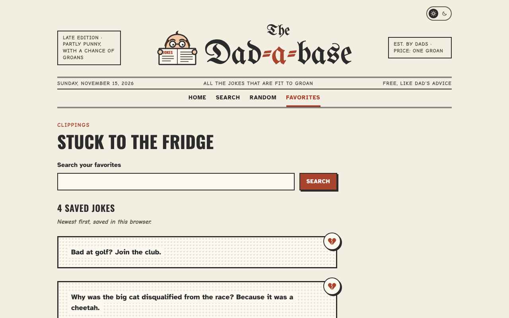            | 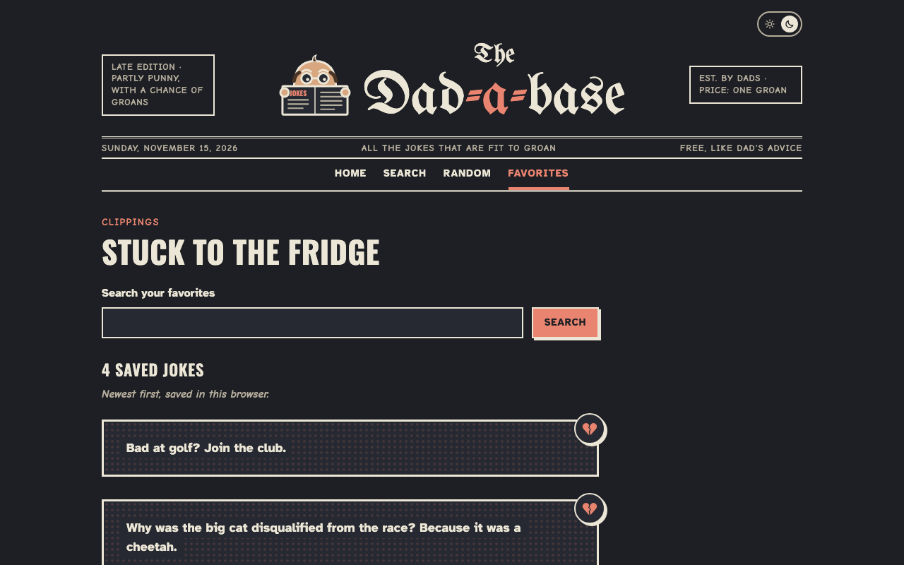      |
| Favorites, phone         | 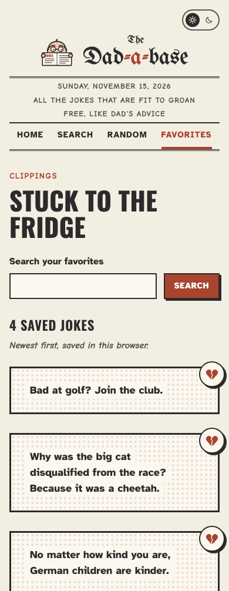              |                                                           |
| Searched                 | 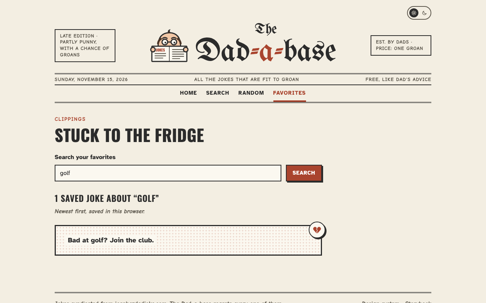   |                                                           |
| No match                 | 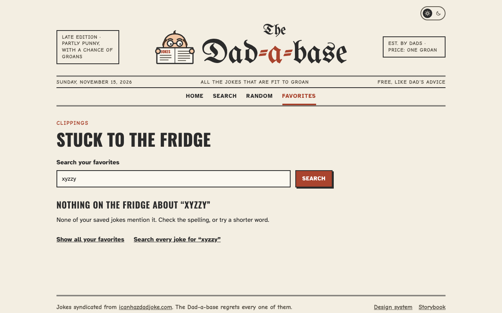 |                                                           |
| Page 2 of 3              | 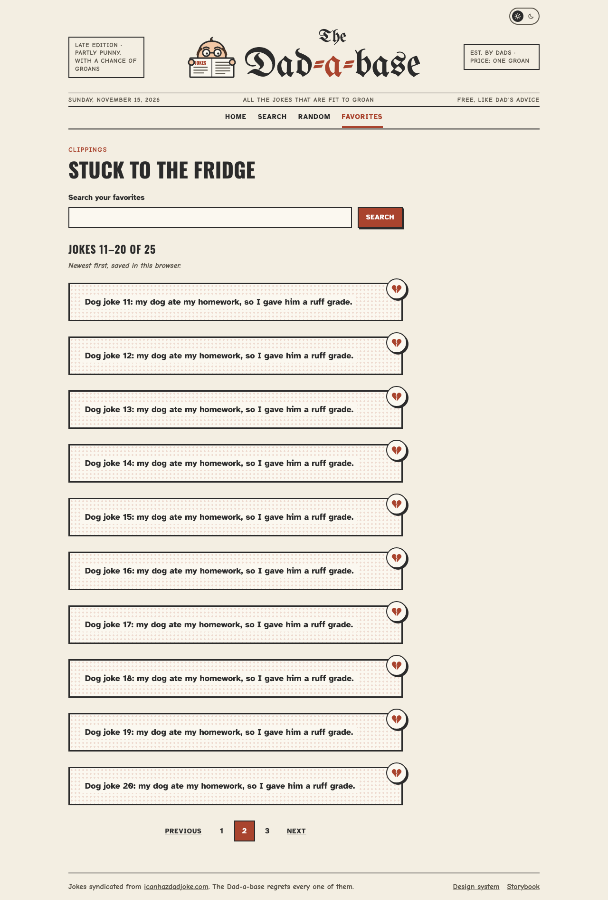     | 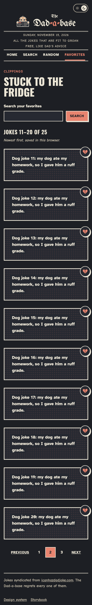 |
| Remove, its tooltip      | 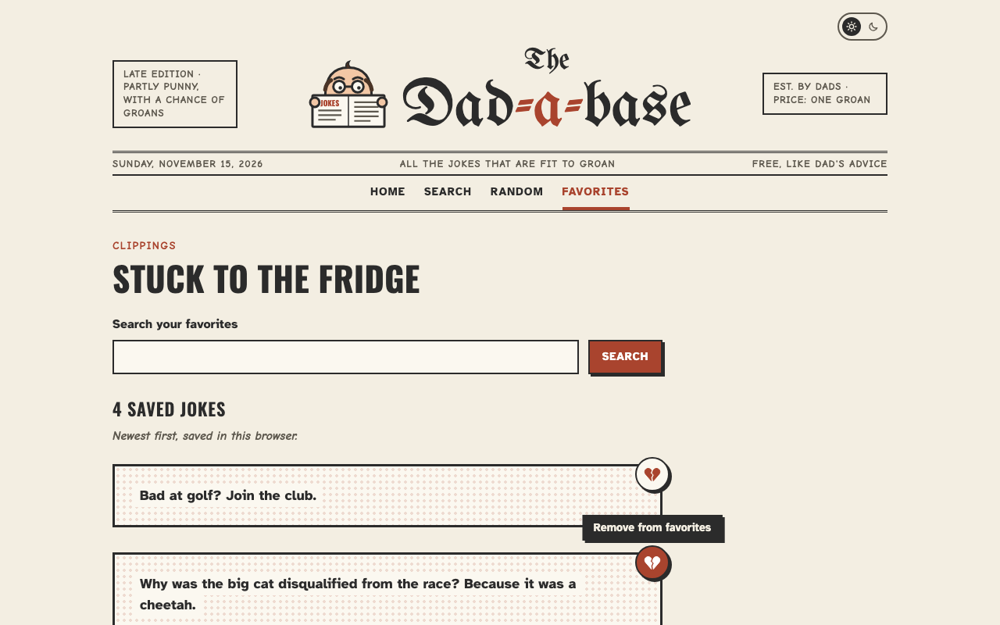    |                                                           |
| A Joke falling off       | 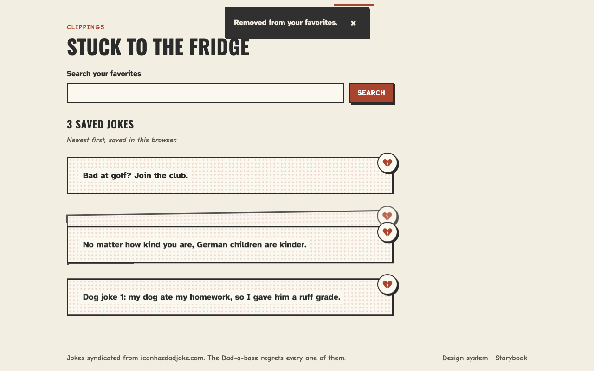   |                                                           |
| A Joke's page, saved     | 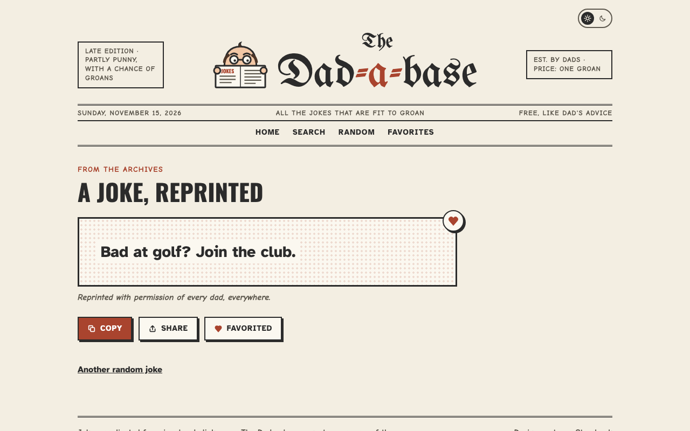           |                                                           |
| None saved yet           | 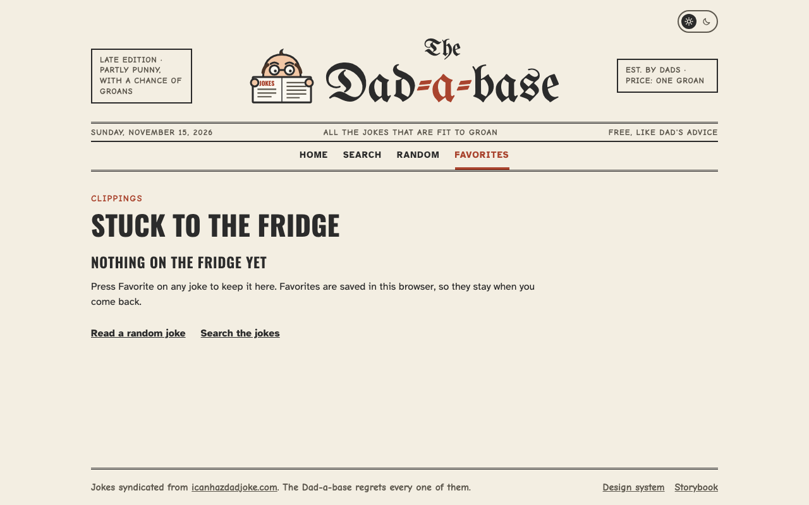      | 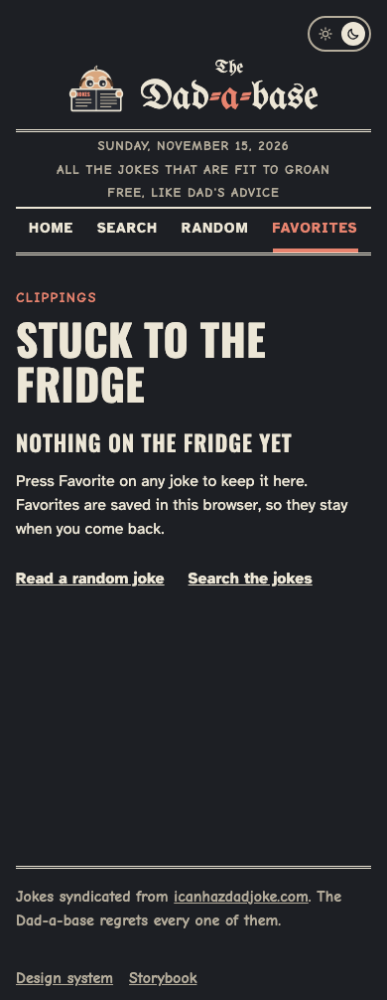  |
| Home, the Favorites peek | 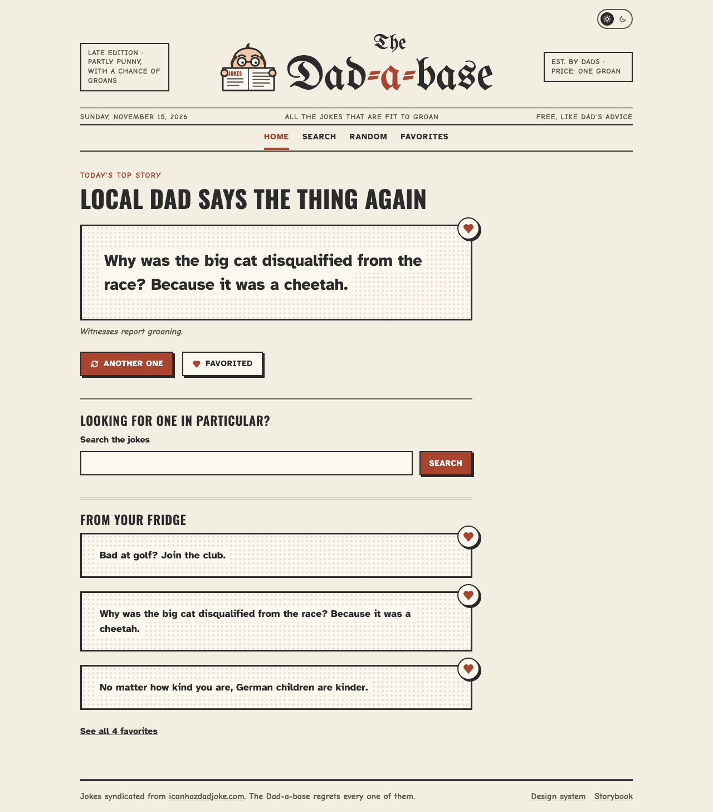            | 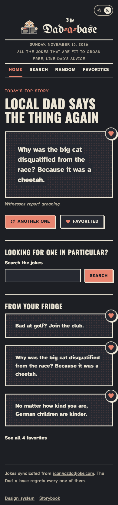        |

## Decisions

Defaults, not asked: the author said "move on to milestone 5".

- **The page reads the store, not the API.** The store has kept whole Jokes since milestone 3, so the list renders at once, offline too. A test counts requests and expects none.
- **Opening a Favorite needs no request either.** The page and the peek write their Jokes into Apollo's cache as `Joke:id` with a `JokeFields` fragment (`useCachedJokes`), and `Query.joke` already reads `Joke:id` (milestone 3). So a Favorite saved last week, and never fetched this visit, opens from the cache like a search result.
  - The write must include `__typename`. Without it the cache can't match the data to `on Joke`, and it stores the entry with no fields.
  - Rejected: fetching a Favorite's page as normal. It works, but the spec promises one cache entry per Joke wherever it was opened from.
- **The list is the store's, so it follows other tabs.** A Joke saved or removed in another tab appears or goes here too (the store has followed other tabs since milestone 3).
- **The heading counts what's saved:** "4 saved jokes" or "1 saved joke". A note under it says they're newest first and saved in this browser.
- **Rejected: a "Clear all" button.** One mistake loses every Favorite, and there are never many.
- **The empty state is plain, like Search's no results:** "Nothing on the fridge yet", how to save one, that Favorites stay in this browser, and links to a random Joke and to Search. It isn't an Error state.
- **The voice.** Kicker "Clippings", headline "Stuck to the fridge": where a dad keeps the cuttings he likes. The page title and navigation say "Favorites", as the glossary does. The peek is "From your fridge".
- **Home's peek is the newest three,** as compact linked cards, then "See all 4 favorites", or "Go to your favorites" when all of them are showing. It's absent until there's one, so a new visitor's home is unchanged. Saving the Joke of the moment adds it to the peek straight away.
- **The heart animates when pressed,** at the author's request. Saving squashes the heart, pops it to 1.35×, and bursts a dotted ring from it, the halftone's dots again, in 450–500ms. Taking a Joke off shrinks the heart briefly. Each press re-keys the heart, so a second press replays it, and nothing plays on first render. Reduced motion turns both off.

### Asked for after the first preview

The author tried the page locally and asked for these.

- **Removing has its own button, pinned over the card's corner,** in place of the Favorite toggle on each card. It's a round button, like a magnet holding the clipping to the fridge, straddling the frame's top-right corner (`JokeCard`'s new `corner` slot, which sits above the card's link). Its icon is a solid broken heart: the Favorite heart's shape, cracked from the dip to the tip, its halves pulled apart, in the saved heart's red. On hover the button turns red and the heart takes the button's text colour.
  - This replaces the first version, where each card had the Favorite toggle and a Joke taken off stayed in place, unpressed, until the visitor left. That kept focus and gave an undo for free. A removed card now goes, so there's no undo, but the toast still says what happened.
- **Removing animates the card off the fridge.** It drops, tilts 4° and fades over 300ms, while the cards below slide up into its place (a `TransitionGroup`). The last card falls too, before the empty state takes its place. Reduced motion removes it at once.
  - The falling card is pinned where it was before it leaves the flow (`@before-leave`). Without that, absolute positioning moved it, Vue gave it the move class, and that rule's transition replaced the fade, so it vanished at once.
- **Focus after removing** goes to the next card's Remove button, the one before if it was the last, or the empty state's heading once there are none. A falling card's button doesn't count. The empty state takes focus only when the visitor removed the last card here, not when another tab did.
- **The Remove button has a tooltip,** "Remove from favorites", which is also its accessible name. It shows on hover and on keyboard focus, stays while the pointer moves onto it, and Escape hides it until the pointer or focus comes back (WCAG 1.4.13). It's centred over the button. Below 50rem, where the card reaches the screen's edge, its right edge lines up with the button's instead, so it never runs off a phone's screen. Pressing the tooltip itself does nothing.
  - Rejected: a `title` attribute. Keyboard users never see it, it waits a second, and it can't be dismissed.
- **The Favorite button says "Favorited" once a Joke is saved.** So it's no longer a toggle (`aria-pressed`): a toggle's name has to stay the same in both states, and "Favorited, toggle button, selected" says it twice. Its label now carries the state, and the toast still announces each change. Playwright matches names by substring, so the e2e tests now ask for exact names.
- **The heart is redrawn:** two even lobes with straight sides meeting at a point, in place of a lopsided shape with a blunt tip.
- **Copy and Share have icons,** drawn like the heart: two sheets for Copy, which become a tick while it says "Copied", and an arrow rising out of a tray for Share.
- **Favorites can be searched,** with the same box as Search, labelled "Search your favorites". It filters the saved Jokes in the browser (`filterFavorites`), ignoring case and accents, so there's no request and no pause: the list follows each keystroke. The term is in the address as `?q`, typing replaces the history entry, and Back or a link changing it moves focus to the heading, as on Search. The count is announced once typing pauses. A term with no matches says "Nothing on the fridge about “xyzzy”", with links to show every Favorite and to search every Joke for the term.
- **Favorites are paged ten at a time,** with Search's Pagination window and `?page`, so a page can be linked to. The heading reads "4 saved jokes" on one page, and "Jokes 11–20 of 25" over several, with "about “dog”" when filtered. Turning a page moves focus to it. A bad or out-of-range `?page` is replaced, and so is the page left empty when its last Joke is removed, with focus on the heading.
  - Only a removal animates. Cards a filter or a new page takes away just go: the list's transition turns its CSS on only while a card is falling. Without that, typing a term made every other card fall off the fridge.
  - The page's address watchers check they're still on `/favorites`, so they never rewrite another page's address while the router is leaving.
- **A Favorite wears a heart wherever its card shows:** home, Random, a Joke's page, Search and the peek. It's a solid red heart in a round badge on the frame's top-right corner, like the Remove button but not a control, so clicks pass through it to the card. It reads "One of your favorites". It pops on when the Joke is saved and fades when it's taken off, and not with reduced motion. On the Favorites page the Remove button takes its place.
- **"Another one" has an icon,** two arrows chasing each other round, which spin while the next Joke loads (not with reduced motion). The button is unavailable meanwhile, so presses can't stack up requests. It stays busy for at least half a second (`useMinimumBusy`), at the author's request, so a quick answer doesn't make it flicker. The new Joke still shows the moment it arrives.
  - `AppButton` has a `disabled` prop for this. It sets `aria-disabled`, ignores presses and dims the button, but keeps focus. The `disabled` attribute, which it used before, drops focus to the top of the page the moment the button is pressed, so a keyboard user asking for another Joke had to find the button again each time. It also looked no different.
- **Tests use real transitions,** not Test Utils' stubs (`src/test/setup.ts`), so a `TransitionGroup` renders its own list and reports when a card has left. jsdom runs no CSS transitions, so they finish on the next frame.
- **Storybook now has an Apollo client,** like its router and Pinia, because the peek writes to the cache. Stories still make no requests.

## Problems found on the way

- **The cache write stored an empty Joke.** `Joke:daaUfibh` was in the cache with no fields, so opening it would have fetched. Found by the cache test, fixed by adding `__typename`.
- **A Storybook run failed with a stale cache again,** this time for every story file. Clearing `node_modules/.cache/storybook` fixed it. CI starts cold, so it isn't affected.
- **Safari doesn't focus a button when it's tapped,** so a first version that checked whether focus was in the list before focusing the empty state never did on an iPhone. The page now remembers that the visitor removed the last card instead.
- **The tooltip used the browser's default font.** Buttons don't inherit it; `AppButton` sets `font: inherit`, and now so does the Remove button.
- **WebKit loaded the next page before a seeded Favorite landed.** The Favorites tests wrote localStorage on one page, then navigated, and on mobile WebKit the next page sometimes started empty. They now seed with an init script that runs once per tab, before the app's code.
- **The Design system test had no Pinia,** which `JokeCard` now needs for its heart.
- **The init script reran on reload.** The first Playwright test for "gone after a reload" saved the Joke again on every load. It now saves once, before going to the page.

## Tests

- **Vitest:**
  - `FavoritesView`: the empty state, its links and the title; newest first, each linking to its page, with a Remove button each and no requests; the Favorites written to the cache; removing one, with the toast, the count and what's saved, after it has fallen, and focus on the next Remove button; focus on the one before when the last is removed, then on the empty state after the last card has fallen; a Joke saved in another tab joining the top;
  - `filterFavorites`: an empty term, case and spaces, accents either way, order kept, and no match;
  - `FavoritesView` searching and paging: filtering as you type with focus kept, the address, the title and the announcement; no matches, with its links; ten a page, turning a page with focus on the heading; three bad `?page` values replaced; removing the last Joke on the last page going back a page;
  - `useMinimumBusy`: held for the minimum after a quick load, not after a slow one, following a first load, starting again, and clearing its timer;
  - "Another one" unavailable while loading, keeping focus, ignoring a second press, then available after the minimum;
  - the Favorite button's label, "Favorite" then "Favorited", on a Joke's page and the random Joke;
  - `App`: saving the Joke of the moment, the peek showing it, its link to Favorites with focus on the headline, and opening it with no request; the main navigation now ending with Favorites.
- **Storybook:** a Favorite's card wearing its heart; the peek with none, a few, and more than three; the Remove button, named by its tooltip, with the tooltip itself not pressing it; the Favorite button's label changing, and no `aria-pressed`.
- **Playwright,** on three browsers:
  - a Joke saved on home showing in the peek, then on Favorites through the navigation, then opening as "Favorited";
  - removing a Joke, focus on the next Remove button, still gone after a reload, then removing the last and focus on the empty state;
  - the tooltip on hover, Escape hiding it, and pressing it not removing the Joke;
  - searching Favorites as you type, paging to page 3 with focus on the heading, and Back;
  - a Favorite's heart on Search but not on the Favorites page, and reflow at 320px with a heart on home, a Joke's page, Favorites and Search;
  - axe on `/favorites?q=xyzzy` too;
  - axe in both themes on `/favorites` with Favorites, and on its empty state with every other route; reflow at 320px.
- **Totals:**
  - Vitest and Storybook: 257 passed, 99.1% of statements and 95% of branches.
  - Playwright: 244 passed, 5 skipped (milestone 3's three and milestone 2's two).

## VoiceOver pass

**Status: passed.** The author ran this pass on 2026-11-15, and it cleared, search, pages and the hearts included. On a Mac and an iPhone:

1. On home with nothing saved, there's no "From your fridge". "Favorite, button" on the Joke of the moment announces "Saved to your favorites.", reads "Favorited", and "From your fridge" appears after the search box.
2. In the peek, each link reads its Joke, then "Go to your favorites".
3. The main navigation reads four links, and on `/favorites`, "Favorites, current page".
4. `/favorites` focuses "Stuck to the fridge", then reads "4 saved jokes", the note, and a list of 4 items: each a Joke's link, then "Remove from favorites, button".
5. Pressing one announces "Removed from your favorites.", focus moves to the next "Remove from favorites", and the heading reads "3 saved jokes".
6. Removing the last moves focus to "Nothing on the fridge yet", then the advice and the two links follow.
7. On a Joke's page, "Copy", "Share" and "Favorite" read without their icons, and a saved Joke's card reads "One of your favorites, image".
8. On `/favorites`, "Search your favorites, search field". Typing "dog" keeps focus there, then announces the count once.
9. With more than ten, the "Pages" navigation follows the list, and Next moves focus to "Jokes 11–20 of 25".

## Open

- **Removing has no undo.** The toast says what happened, but it has no button. An "Undo" there would need the toast region to hold controls and keep focus reachable.
- **The Remove buttons all have the same name.** Each follows its Joke's link, so it reads in context, but a screen reader's list of buttons shows "Remove from favorites" four times.
