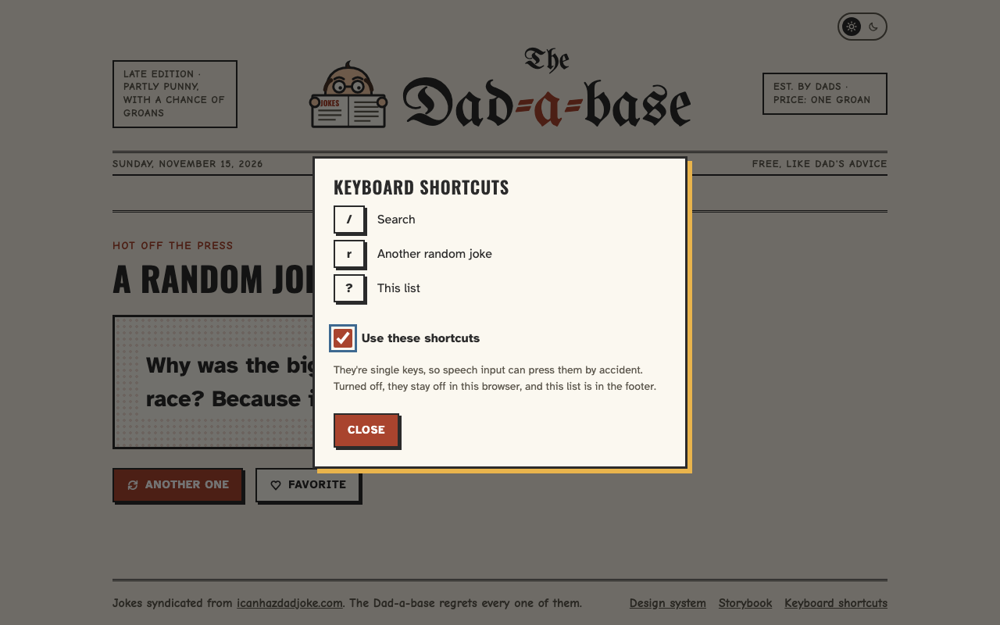
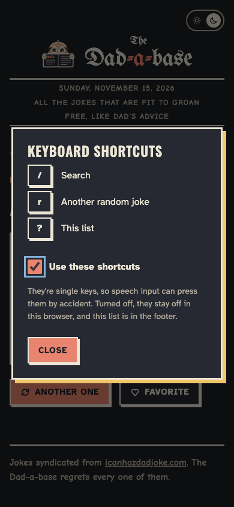
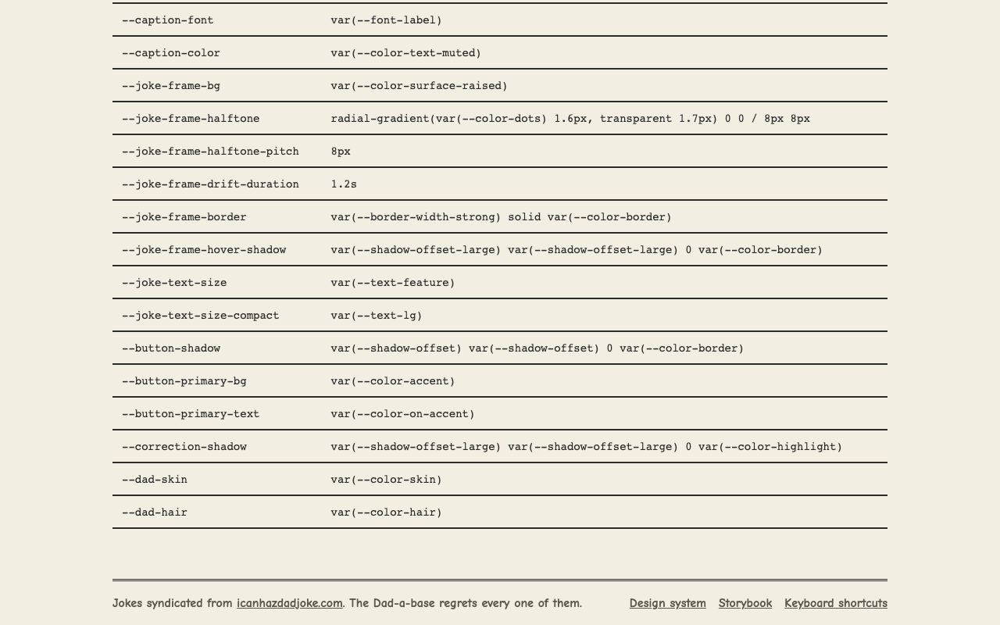

# 0006 · Keyboard shortcuts and transitions

Milestone 6. `/` goes to a search box and `r` to another random Joke, from anywhere. `?` lists them, with a switch to turn them off, and so does a footer link. Each new page fades up as it arrives, and so does each new Joke. None of it moves under reduced motion.

## After

| Screen                    | Light                                                             | Dark                                                           |
| ------------------------- | ----------------------------------------------------------------- | -------------------------------------------------------------- |
| The shortcuts, listed     |  |  |
| The footer's link to them |     |                                                                |

## Decisions

Defaults, not asked: the author said "next milestone".

- **What each key does depends on the page.** A page gives a key its meaning while it's showing (`useShortcut`), and the latest to ask wins. Otherwise the key goes where it can.
  - `/` focuses the page's own search box: home's, Search's or Favorites'. Anywhere else it goes to Search, then focuses its box, after the navigation has moved focus to the headline.
  - `r` asks for another Joke where there is one, on home and Random, and is ignored while "Another one" is busy, as the button is. Anywhere else it goes to Random.
  - `?` opens the list. No page can take it over.
- **A key is only a shortcut when it can't be anything else.** Not while typing in a field, a select or anything editable; not with Control, Command or Option held, which belong to the browser and the screen reader; not mid-composition; and not with a dialog open. `/` is claimed with `preventDefault`, since Firefox's quick find also listens for it. A capital R isn't `r`.
- **They can be turned off (WCAG 2.1.4).** Speech input can press a single key by accident, so the list has a "Use these shortcuts" switch. Off is remembered in this browser (`dadabase:shortcuts`). Turned off, `?` does nothing either, so the list is also a footer link, "Keyboard shortcuts".
  - Rejected: shortcuts with a modifier, such as Alt+R. They clash with browsers and screen readers, and they're harder to remember.
- **The list is a native modal `<dialog>`.** It holds focus, Escape closes it, and closing it returns focus to whatever opened it, with no code of ours. Its backdrop uses a new semantic colour, `--color-scrim`, black in both themes, from a new primitive, `--black`. Built from the text colour, it lightened the page in the dark theme instead of dimming it.
- **Pages fade up as they arrive, and don't animate out.** A `<Transition>` with a leave and `out-in` would hold the new page back until the old one had gone, after focus had already moved to a headline that wasn't there yet. Each page's wrapper is keyed by its path and plays a 250ms fade and 0.75rem rise as it mounts. A new query on the same page, such as typing a Search, doesn't replay it. The spec's "with `<Transition>`" is now "as they arrive".
- **A new Joke arrives the same way,** keyed by its id, so "Another one" or `r` shows that something changed even when two Jokes start alike.
- **Reduced motion turns both off,** as it does every animation on the site.

### Asked for while building

- **A linked card's dots change colour on hover,** fading over 300ms from their usual pale red to the accent at 40% while they drift. The halftone token baked its colour in where it was declared, so it's now its parts, as domain tokens: `--joke-frame-dots`, `--joke-frame-dots-hover`, `--joke-frame-dot-size`, `--joke-frame-dot-edge` and the pitch. The card draws the dots from a registered colour property (`@property --joke-frame-dot-color`), which is what lets a gradient's colour transition. Reduced motion jumps straight to the new colour.

## Problems found on the way

- **Axe failed 100 tests at once,** on contrast, across every page. It was measuring each page while it was still fading in. Every axe test now waits for the page to settle first (`e2e/settled.ts`): fonts loaded and every finite animation finished, looked for again after a couple of frames, since home's Joke loads, and starts its own arrival, after the page.
- **jsdom has no modal dialogs.** The test setup stands in `showModal` and `close`, with its close event.

## Tests

- **Vitest:**
  - `shortcutFor`: the three keys; other keys and a capital R; Control, Command and Option; composition and an event already handled; a text field, a text area, a select and something editable; an open dialog;
  - the shortcuts store: on by default, off remembered and cleared, the latest page's handler winning and only its own taken back, and blocked storage;
  - `App`: `/` focusing home's box without navigating, and going to Search from Random with its box focused; `r` showing another Joke on Random without changing the address, and going to Random from a Joke's page; `r` typed in the search box; `?` opening the list, turning them off, `r` and `?` then doing nothing, and the footer link opening it again.
- **Storybook:** the list open, turning the shortcuts off, and Close.
- **Playwright,** on three browsers:
  - `/` from Random to Search, then typing; `r` on Random, and as a letter in the search box;
  - `?`, with `r` ignored while the list is open, and Escape returning focus to "Another one";
  - turned off, still off after a reload;
  - a page's arrival animating, and not with reduced motion;
  - axe on the open list in both themes, and every axe test waiting for the page to settle.
- **Totals:**
  - Vitest and Storybook: 280 passed, 99.2% of statements and 95.4% of branches.
  - Playwright: 265 passed, 5 skipped (milestone 3's three and milestone 2's two).

## VoiceOver pass

**Status: passed.** The author ran this pass on 2026-11-15, and it cleared, the shortcuts list and its switch included. On a Mac and an iPhone:

1. On Random, `?` opens "Keyboard shortcuts, dialog", reading its heading, the three keys and what they do.
2. "Use these shortcuts, checkbox, checked". Unchecking it reads "unchecked".
3. Escape, or "Close", closes it, and VoiceOver is back where it was.
4. The footer's "Keyboard shortcuts, button" opens it again.
5. `r` on Random: the new Joke is read, from the story's live region.
6. `/` from Random: VoiceOver lands in "Search the jokes, search field".

## Open

- **A screen reader may take the keys first.** If the VoiceOver pass finds `r` or `/` don't reach the page, that's the screen reader's own navigation, and the footer link and the buttons still do the same jobs.
