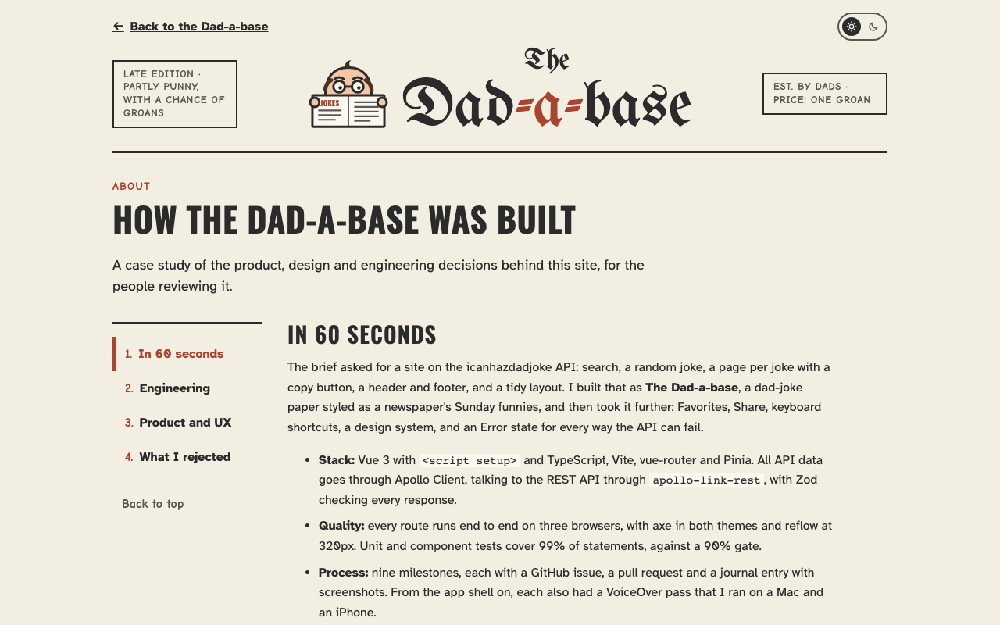
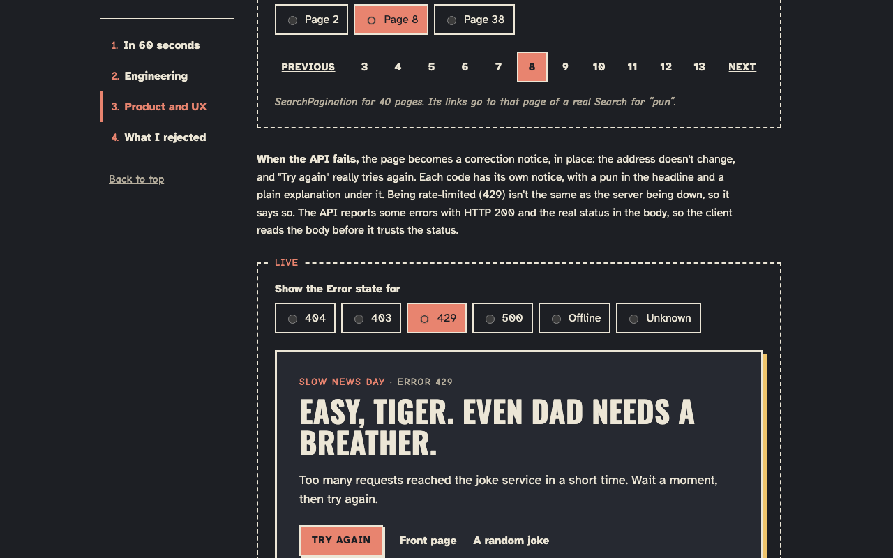
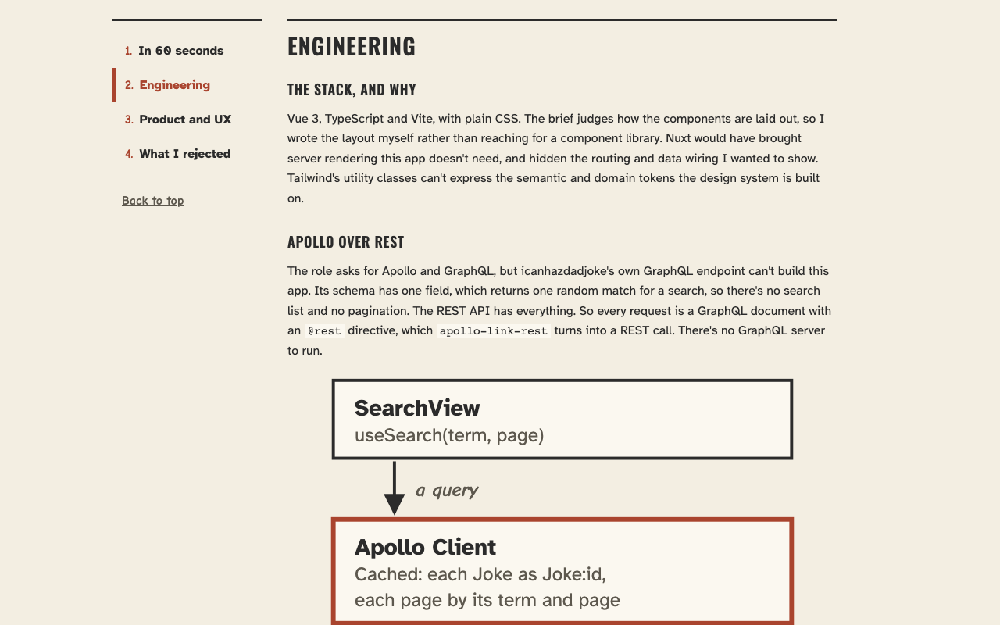
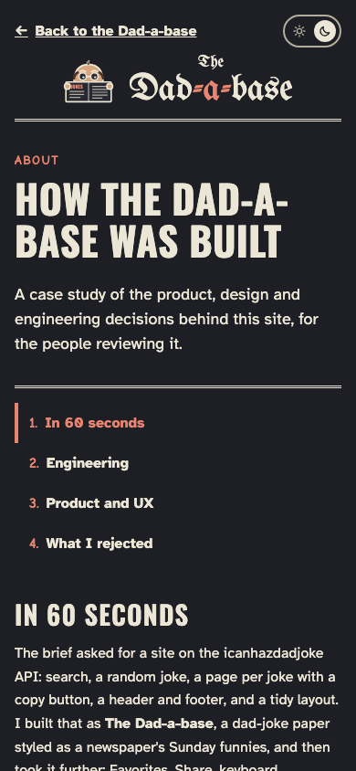
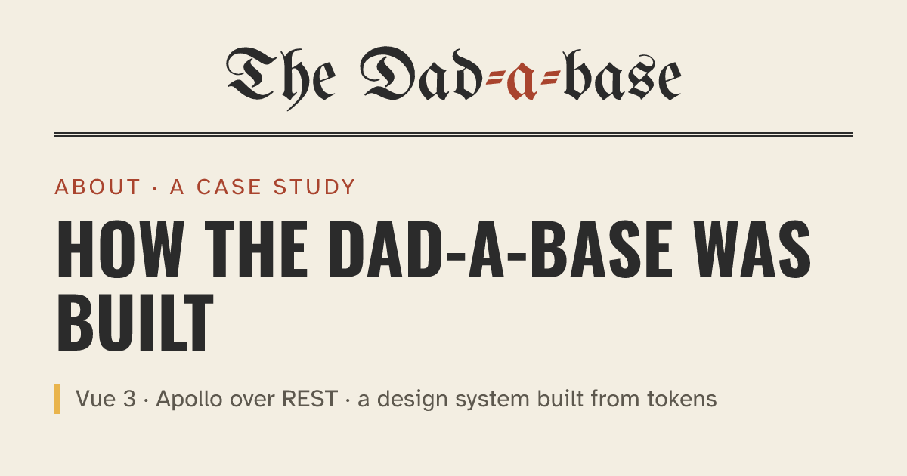

# 0007 · The Case Study

Milestone 7. `/case-study`, linked as "About" in the main navigation and "Case study" in the footer, explains how and why the Dad-a-base was built, for the people reviewing it. It's written in MDX, so its prose holds the app's own components, live, beside the decisions they show. It has two inline SVG diagrams, and an Open Graph image made at build time for link previews.

## After

| Screen                  | Light                                                               | Dark                                                          |
| ----------------------- | ------------------------------------------------------------------- | ------------------------------------------------------------- |
| The Case Study, desktop |              |  |
| A chapter, followed     |  |                                                               |
| Phone                   |                                                                     |           |
| The Open Graph image    |                              |                                                               |

## Decisions

Defaults, not asked: the author said "next milestone".

- **MDX, compiled to Vue's own JSX runtime** (`@mdx-js/rollup` with `jsxImportSource: 'vue'`). The prose imports the app's components and gives them props, as ADR 0003 planned. No JSX plugin is needed: Vue ships `vue/jsx-runtime`. Links in the prose go through a `ProseLink`, so the app's own pages use the router.
- **The live embeds are the real components, in fixed states,** each in a dashed figure tagged "Live":
  - the Pagination window, switchable between pages 2, 8 and 38 of 40, with links into a real Search;
  - every Error state, switchable by code, its "Try again" saying what it would do in the app;
  - a Joke card;
  - `ThemeSpread`, showing a button in both themes at once.

  A switch is a radio group (`StatePicker`), so the arrow keys move it.

- **`ErrorView` takes a heading level.** At 1, the default, it's the page and titles it. In the Case Study it's a level-3 heading under its chapter and leaves the title alone, so the page keeps one `h1`. Its copy now follows its `code`, so one embed can switch between them.
- **Two diagrams, drawn as inline SVG** (`FlowDiagram`): how a Search reaches the API and comes back, and one colour through the three token layers. They run top to bottom, so they read at a phone's width, take their colours from the theme's tokens, and are images named by a title with a full text description for screen readers. The three homes for state are a list, not a diagram: it reads better as three questions.
- **The content is checked against its sources,** as ADR 0003 asks: the spec, the ADRs, the journals and this milestone's own work. Three claims in the first draft overreached and were cut: a VoiceOver pass "each milestone" (milestones 0 and 1 had none), Favorites "working offline", and "a dozen rounds" of review.
- **"Building with Claude" says how it was built,** plainly: the spec and rules first, Claude building each milestone to them and recording its own defaults, the author reviewing and steering, Claude flagging the accessibility catches in some requests, and the author keeping pushes, pull requests and the VoiceOver passes.
- **The Open Graph image is made at build time** (`build/ogImage.ts`): Satori lays it out with the site's fonts, resvg renders it to a 1200 by 630 PNG, and its colours are read from `primitive.css`, so it uses no colour the tokens don't have. The same plugin writes `case-study.html`, the built `index.html` with the Case Study's title, description and Open Graph tags, and `vercel.json` serves it for `/case-study`. Link previews don't run the app, so tags set at runtime would never be seen. Storybook's build leaves the plugin out, since it has no `index.html` to tag.

### Asked for while building

The author reviewed the first version running and asked for these.

- **A slim header.** The Case Study keeps the Masthead, the theme toggle and a "Back to the Dad-a-base" link, and drops the dateline and the main navigation (`SiteHeader`'s `slim`, set by the route's `meta`). The footer stays.
- **Chapters in a sticky column on the left,** with the text scrolling past, after MySous's case study. They mark the chapter being read (`aria-current="location"`): the last whose heading has passed the top third of the screen, or the last chapter at the foot of the page, whose heading never gets that high. On a narrow screen, the chapters sit above the text.
- **Back to top,** under the chapters and at the end. It scrolls to the top of the page, Masthead and all, and focuses the headline.
- **Engineering before Product and UX.**
- **Smooth scrolling between chapters,** instant under reduced motion. The router used to jump to a `#hash` too, which cut the glide short, so on the same page it now leaves scrolling to the page. Following a chapter moves focus to its heading, even when it's already the address.
- **A footer link,** "Case study", beside the design system and Storybook. The footer's links now wrap.

## Problems found on the way

- **Prettier broke the chapter headings.** Written as `<h2 id>` in MDX, it spread each onto three lines, and MDX wraps a multi-line heading's text in a `
`. The chapters are plain `##` headings now, and `rehype-slug` gives them ids from their text.
- **The prose styles leaked into the live components.** The rule spacing list items lifted the Pagination window's first number. The prose now styles only its own elements, the article's direct children.
- **Safari lost a chapter linked to directly.** Web fonts load after the router has scrolled, re-flow the text above, and Safari has no scroll anchoring to hold the place, so the heading ended up 67px off the top. Arriving at a chapter now holds it in view while the page settles, for up to three seconds or until the visitor scrolls, taps, clicks or types. A first fix, scrolling again once `document.fonts.ready` resolved, wasn't enough: it can resolve before the fonts have started loading.
- **A test clicked "About" before the first navigation had finished,** so the router treated it as the first page load, which keeps focus where it is. The test waits for the page now.
- **Satori adds padding to a box's width,** so the first image's rule ran off the edge. Its column is sized directly.
- **jsdom has no layout, `matchMedia` or `scrollIntoView`.** The page guards the last two, and what needs layout, the chapter being read and arriving at a chapter, is tested in Playwright.

## Tests

- **Vitest:**
  - `CaseStudyView`: one `h1` and the title; the chapters, in order, each to a heading that exists; following one, again, and Back to top, with focus; each Error state switched, at level 3, with "Try again" only where it fits, and the title unchanged; the Pagination window at page 8 and 38, linking into Search; both diagrams named and described;
  - `App`: the slim header, with no main navigation, and its way back; "About" and the footer's "Case study";
  - the Open Graph page's tags, title and description, a build failing with no `</head>`, and a 1200 by 630 PNG.
- **Storybook:** `FlowDiagram`, `LiveFigure`, `StatePicker` by arrow key, `ProseLink` inside and out, `ErrorStates` and `PaginationStates`.
- **Playwright,** on three browsers:
  - "About", the slim header and the way back; the footer's link;
  - a chapter followed, focused and marked, and Back to top to the very top;
  - a link to a chapter opening the page there, focused;
  - the chapter being read marked as the page scrolls, on a wide screen;
  - the live Error states and Pagination window by keyboard;
  - the built image and the tagged page;
  - axe in both themes and reflow at 320px on `/case-study`.
- **Totals:**
  - Vitest and Storybook: 297 passed, 96.9% of statements and 93.9% of branches.
  - Playwright: 293 passed, 7 skipped (milestone 3's three, milestone 2's two, and the chapter marking on the two phones).

## VoiceOver pass

**Status: passed.** The author ran this pass on 2026-11-15, and it cleared, the chapters and the live embeds included. On a Mac and an iPhone:

1. "About" opens the page, and focus is on "How the Dad-a-base was built". There's no main navigation, and "Back to the Dad-a-base" is first in the header.
2. The rotor's landmarks list "Chapters", and in it the chapter being read is "current location".
3. Following "Engineering" moves VoiceOver to its heading.
4. "Show the Error state for, group": the arrow keys move between codes, and the notice's headline reads as a heading, level 3.
5. Each diagram reads as an image with its title, then its description.
6. "Back to top" returns to the headline.

## Open

- **The content is the author's to edit.** It's written as "I", from the sources, and every claim is checked against them, but the voice and emphasis are the author's call. ADR 0003 asks for the claims to be checked again before each release.
- **No byline.** The page doesn't name its author.
- **Numbers that move,** such as test counts, are kept out of the prose. Coverage is "over 95%", against the 90% gate, which stays true as it moves.
