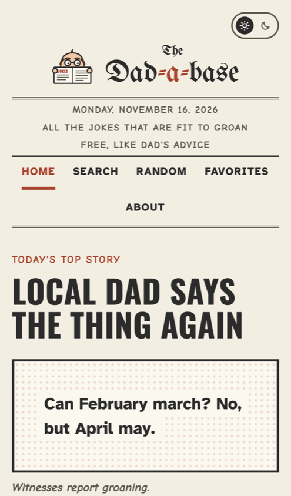
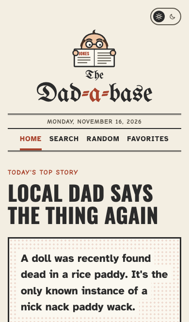
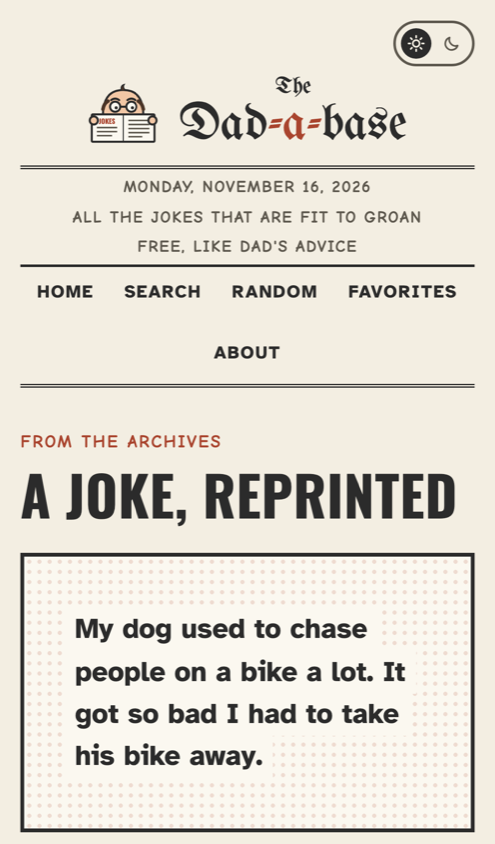
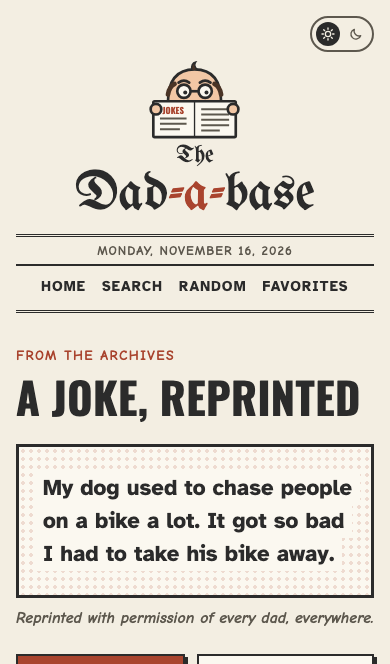
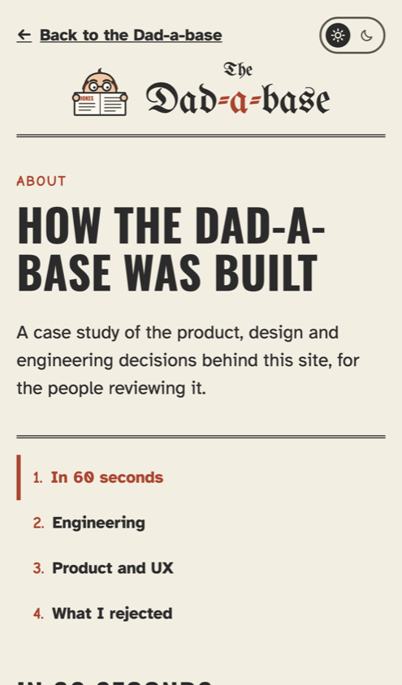
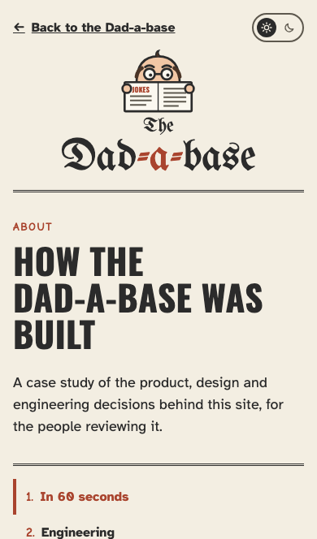
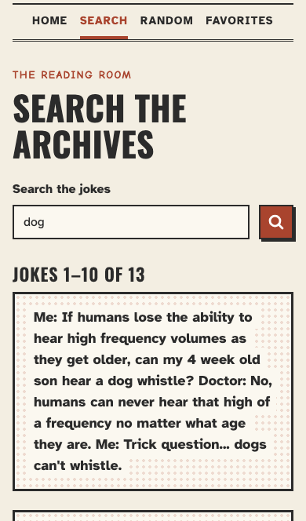
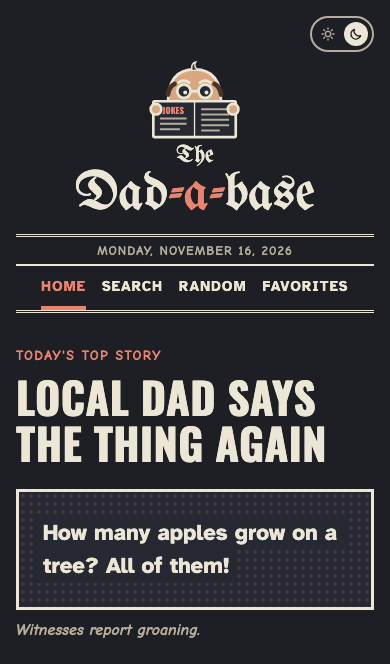
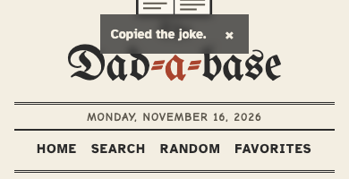
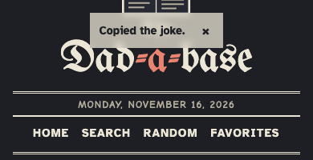

# 0009 · A mobile pass

After milestone 8, a quick pass over the Dad-a-base on a phone. On an iPhone-sized screen, every page was checked for sideways scrolling (there was none), small tap targets and wasted space above the story. What was found was tightened, along with the author's own requests.

## Before and after

| Screen                     | Before                                            | After                                              |
| -------------------------- | ------------------------------------------------- | -------------------------------------------------- |
| Home                       |  |    |
| A Joke's page              |  |    |
| The Case Study             |  |    |
| Search, with the magnifier |                                                   |  |
| Home, dark                 |                                                   |     |
| A toast, light and dark    |  |    |

## Decisions

### Asked for while building

The author reviewed the pass running and asked for these.

- **The Dad above the wordmark,** where the Masthead's container is narrower than 48rem, the same point at which the ears drop out. Each is larger: the Dad is about 93px wide on a phone, up from 56px, and the name about 3.4rem, up from 2.5rem. With the other cuts below, the headline still starts where it did. A wide screen keeps the row with the ears.
- **"About" is out of the main navigation.** The footer's "Case study" link is the way in, as it is to the design system and Storybook. The main navigation is now the paper's own pages. The spec and glossary say so.
- **A magnifier for the Search button,** so the field gets the width: about 300px on a phone, up from 215px. The button's name is still "Search", from visually hidden text, and it's a 44px square.
- **Smaller, semi-transparent toasts.** Smaller text, no border or shadow, and 44px tall instead of about 64px. The background is the text colour at 75% (`--toast-bg`, a new domain token), with a light blur behind it so what scrolls underneath doesn't fight the message. The text passes AA over anything behind it, even pure white or black: at least 5.4:1 in light and 7.3:1 in dark. The Dismiss button keeps its 44px target.
- **Turning a page glides back to the top,** on Search and Favorites, or jumps there under reduced motion. The router does it when only `page` changes. Changing the term, or Back, doesn't. Focus still goes to the results heading, now without scrolling, since the page is already on its way up.
- **No Vue warnings in the console.** MDX compiles to a JSX runtime, and Vue's own passes a component's children as they are, which Vue warns about on every live embed: five on the Case Study. The MDX now compiles to a small runtime of its own (`src/case-study/mdx/`) that passes them as a default slot function, as a template does. It has a development build too, which MDX imports in dev.

### Found on the phone

Defaults, not asked.

- **The dateline is only the date on a phone.** The two mottos took two more lines above the story. A wide screen keeps all three.
- **The main navigation fits one line** from 375px up, with less space between links. At 320px it wraps, as it should.
- **A Joke card has less frame on a phone,** so a Joke runs about a line shorter.
- **A Joke's buttons fill each line they wrap onto,** with their labels centred. Before, Favorite sat alone at the left of the second line.
- **"Dad-a-base" never breaks at its hyphens** in the Case Study's headline, where it split across lines as "DAD-A-" and "BASE".

## Problems found on the way

- **The first runtime broke the Case Study in dev.** MDX imports `jsx-dev-runtime` in development, which didn't exist yet, so the page failed to load, which at first looked like no warnings. Checking that the live embeds had rendered caught it.
- **An `appDefinitions is not iterable` error in `common.js`** isn't the Dad-a-base's. Nothing in the code or its dependencies has that name, and every route loads with no errors in a browser without extensions. It's a browser extension's script.

## Tests

- **Vitest:** the main navigation is Home, Search, Random and Favorites.
- **Playwright:**
  - the footer's "Case study" opens the Case Study with its slim header, replacing the test through "About";
  - turning a page ends at the top of the page, with focus on the results heading.
- **By hand, at iPhone size:** no route scrolls sideways; the navigation is on one line at 375px and 390px, and two at 320px; no Vue warnings or errors on any route.
- **Totals:**
  - Vitest and Storybook: 297 passed, 96.8% of statements and 93.1% of branches.
  - Playwright: 290 passed, 7 skipped. Two Case Study tests became one.

## VoiceOver pass

**Status: passed.** The author ran this pass on 2026-11-16, on an iPhone:

1. The header reads the Masthead, the date and the main navigation, with no mottos and no "About".
2. The magnifier reads "Search, button".
3. Copying a Joke announces "Copied the joke.", and the toast's Dismiss button reads as "Dismiss".
4. Turning a page moves VoiceOver to the results heading, which reads the range.
5. The footer's "Case study" opens the Case Study, on its headline.

## Open

- **Not deployed.** Production is at milestone 8 until this is merged and deployed.
