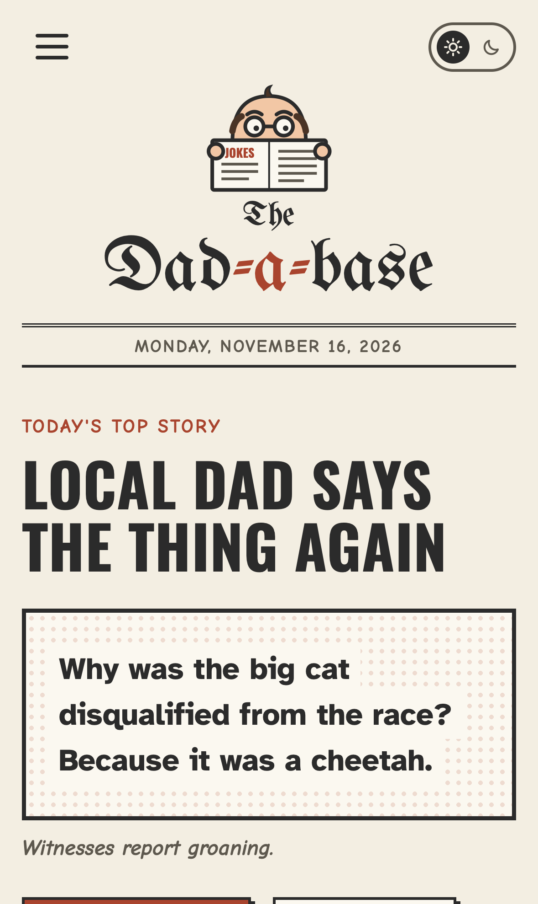
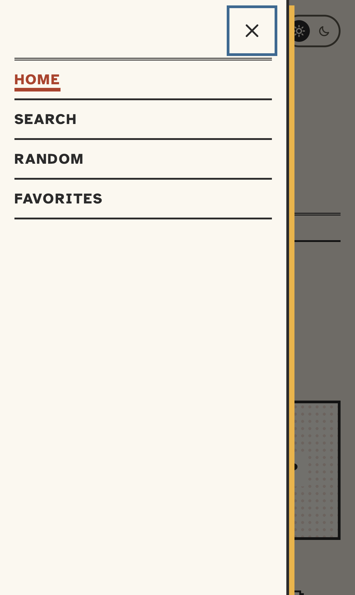
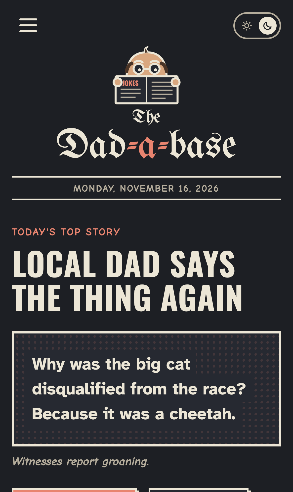
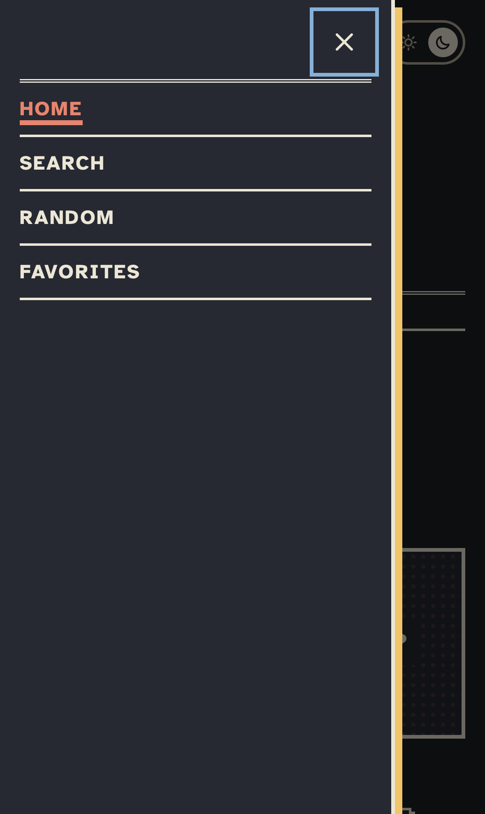
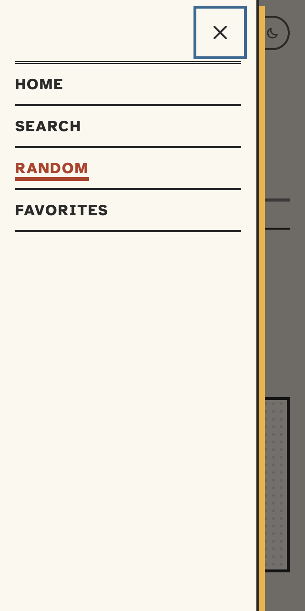
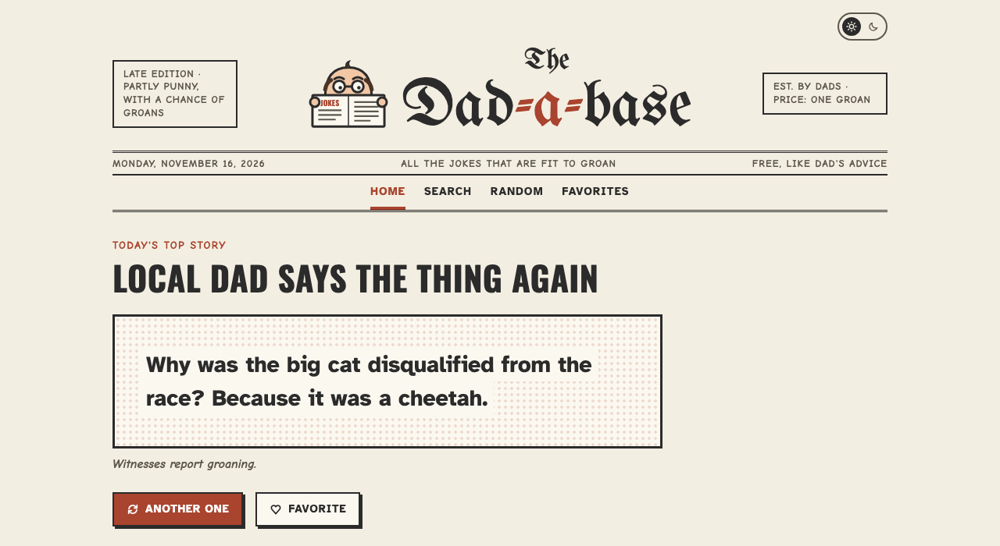

# 0010 · A Sections menu for phones

On a phone, the main navigation now lives in a drawer that slides in from the left, opened by a hamburger button at the top left. A fifth page is coming (the Groan Leaderboard), and five sections don't fit on one line at 320px. The mobile pass had just kept the navigation to one line, so this lands first, by itself, ahead of the Groans work.

## Screens

| Screen                   | Closed                                              | Open                                              |
| ------------------------ | --------------------------------------------------- | ------------------------------------------------- |
| Home, phone, light       |  |  |
| Home, phone, dark        |   |   |
| Random, 320px            |                                                     |  |
| Home, desktop, unchanged |       |                                                   |

## Decisions

### Asked for while building

The first version was a disclosure: a "Sections" button under the dateline that opened the sections as a list, pushing the page down. The author reviewed it and asked for these.

- **The button at the top left,** opposite the theme toggle, opening **a drawer from the left edge.**
- **No visible "Sections" label,** on the button or in the drawer. The button is a hamburger, larger than the Close mark (2rem), and its accessible name is still "Sections", from visually hidden text. The drawer is named "Sections" by `aria-label`.

### Defaults, not asked

- **Only below 40rem,** the breakpoint the header already uses for phones. Wider, the button hides and the header's row of sections shows, as before.
- **A native modal `<dialog>`,** as the keyboard shortcuts list is. A drawer covers the page, so the page behind should be inert and focus should stay inside: `showModal()` gives both, and Escape, for free. `SectionsMenu` is its own component, in the header's top bar.
- **It closes when a section is chosen,** on Close, on Escape, on a tap on the page beside it, on Back or Forward, and if the window grows past a phone's width. Focus goes back to the button, which Chrome does on its own and Safari doesn't, so the component does it. Choosing a section then moves focus on to the new page's headline, as any navigation does.
- **One "Main" navigation at a time.** The drawer's navigation exists only while it's open, and the header's row is hidden on a phone, so there's never two.
- **It slides in over 250ms with the scrim fading up,** and back out again, with `@starting-style` and `allow-discrete`. Under reduced motion it appears and disappears without moving.
- **Inside, it's ruled like a paper's index:** one section a line, each a 44px target. The current section is in the accent and underlined in the word, so it's marked by more than colour.
- **The Case Study's slim header is unchanged.** It has no main navigation, so it has no button.

## Problems found on the way

- **A Storybook test can't press Escape on a native dialog.** Simulated key events aren't trusted, and only a trusted Escape closes a modal dialog. Playwright covers it, as it does for the shortcuts list.
- **The drawer's heading briefly doubled a page's own.** While the drawer slid shut, its "Sections" heading was still showing, and a Favorites test found two level-2 headings. The heading went, with the label.
- **The page's fade-up test counted too soon.** With the drawer, the new page arrives a moment after the click, so the test now waits for the address to change before counting animations.

## Tests

- **Storybook:** `SectionsMenu`'s `Closed`, `Open` (every section listed) and `Closing` (Close, a tap on the backdrop and choosing a section); `SiteHeader`'s `Phone` shows the button and no row of sections.
- **Playwright:**
  - the button shows only on a phone, and the row of sections otherwise;
  - on a phone: the button is at the top left and the drawer opens against the left edge; it lists every section and marks the current one; choosing one closes it and focuses the new headline; Escape closes it and returns focus; Close and a tap beside it close it;
  - open, no axe violations in light or dark, no sideways scrolling at 320px, and the button and every link at least 44px tall.
- **The rest of the suite** goes to a section through a `goToSection` helper (`e2e/sections.ts`), which opens the drawer first on a phone.
- **Totals:**
  - Vitest and Storybook: 300 passed.
  - Playwright: 307 passed, 14 skipped (the phone-only tests on desktop, and those already skipped on WebKit).

## VoiceOver pass

**Status: passed.** The author ran this pass on 2026-11-16, on an iPhone:

1. The top bar reads "Sections, button" then the theme toggle.
2. Double-tapping it reads "Sections, dialog", and swiping right reads Close, then each section, with the current one as "current page". Nothing behind the drawer is reachable.
3. Choosing a section closes the drawer and moves VoiceOver to the new page's headline.
4. Close returns VoiceOver to the Sections button.

## Deployed

In production at <https://the-dad-a-base.vercel.app> since 2026-11-16, from `master` at `5701402`, with Groans (journal 0011) and the refactor after it (journal 0012).
