# 0011 · Groans

A feature for delight: the Visitor presses and holds a **Groan** button to say how bad a Joke is, and the longer the hold, the higher its **Groan score**. Their Groans are ranked on a **Groan Leaderboard** at `/groans`, saved in this browser. It was designed in a grilling session before any code, then tuned with the author by feel.

## Screens

| Screen                       | Light                                           | Dark                                           |
| ---------------------------- | ----------------------------------------------- | ---------------------------------------------- |
| The button, idle             | 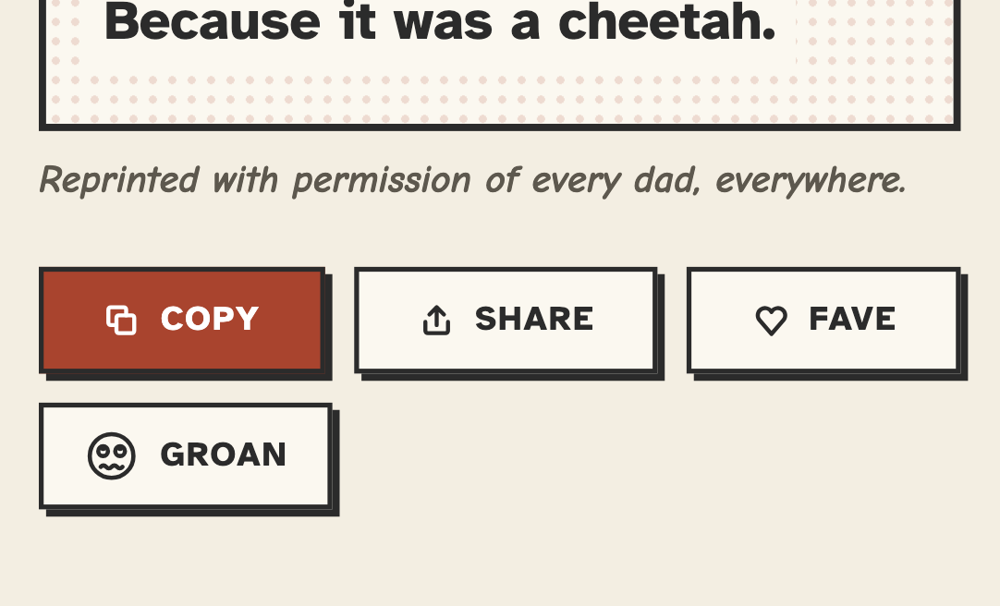    | 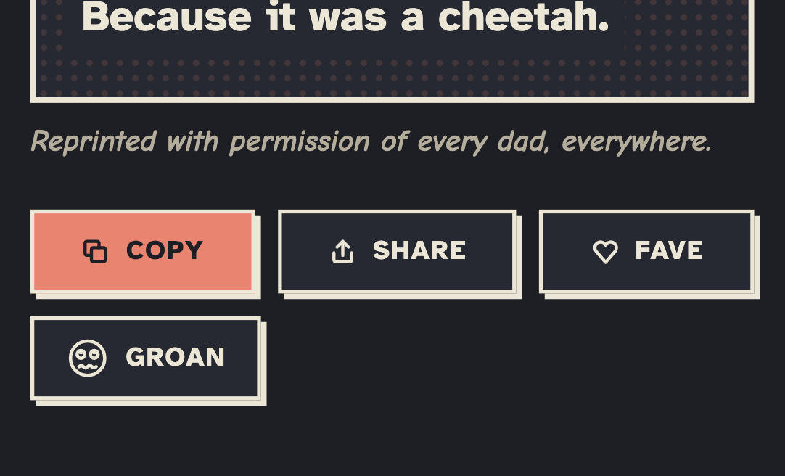    |
| Held, about a second in      | 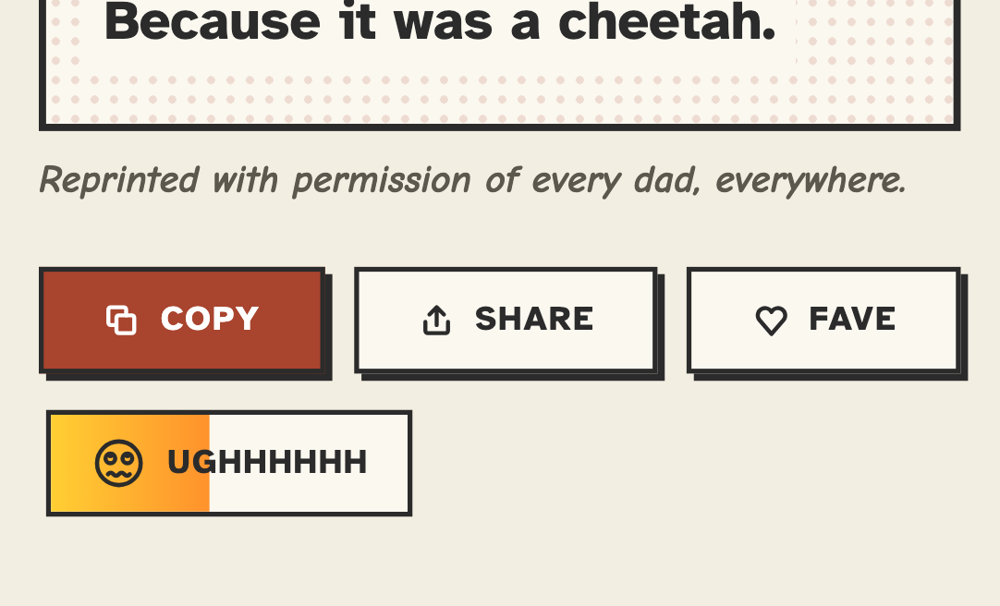 | 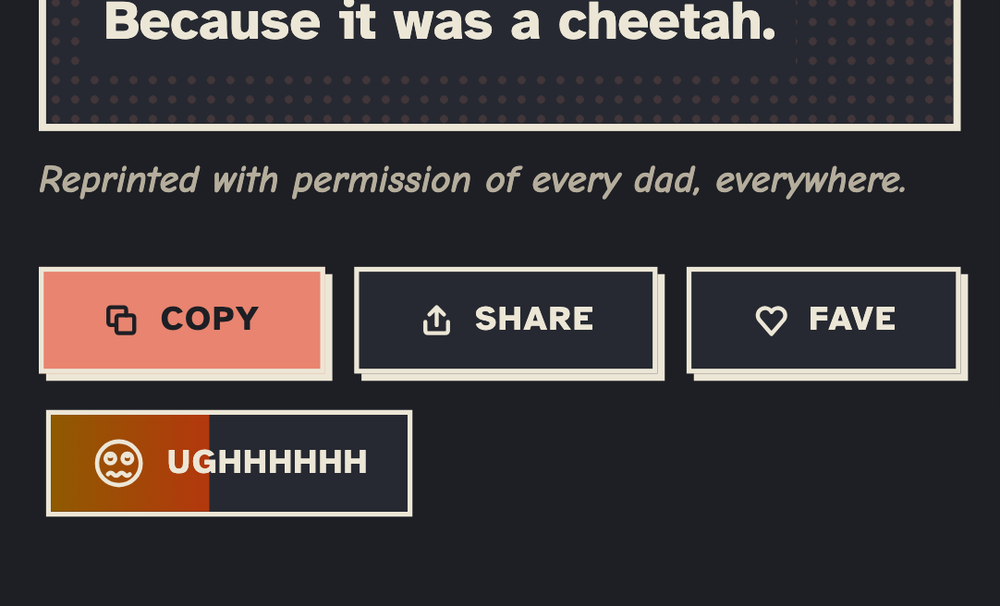 |
| Held to full, shaking        | 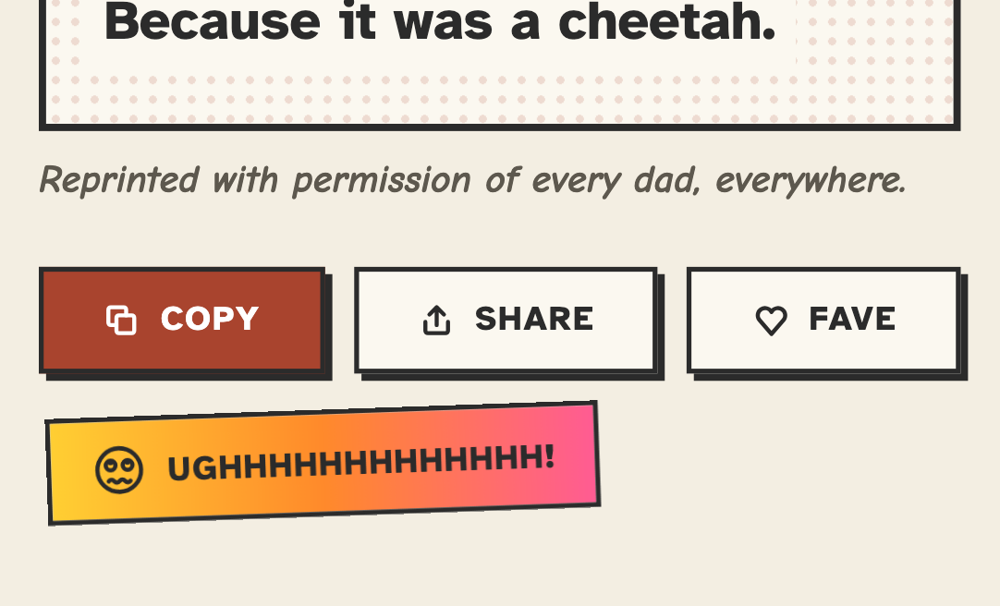    | 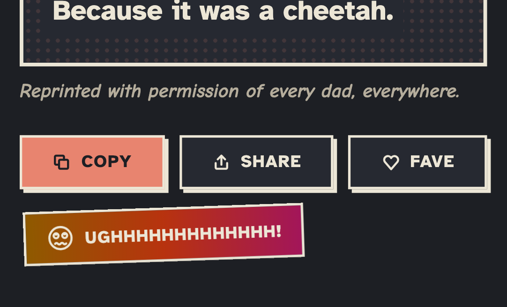    |
| Let go: the burst            | 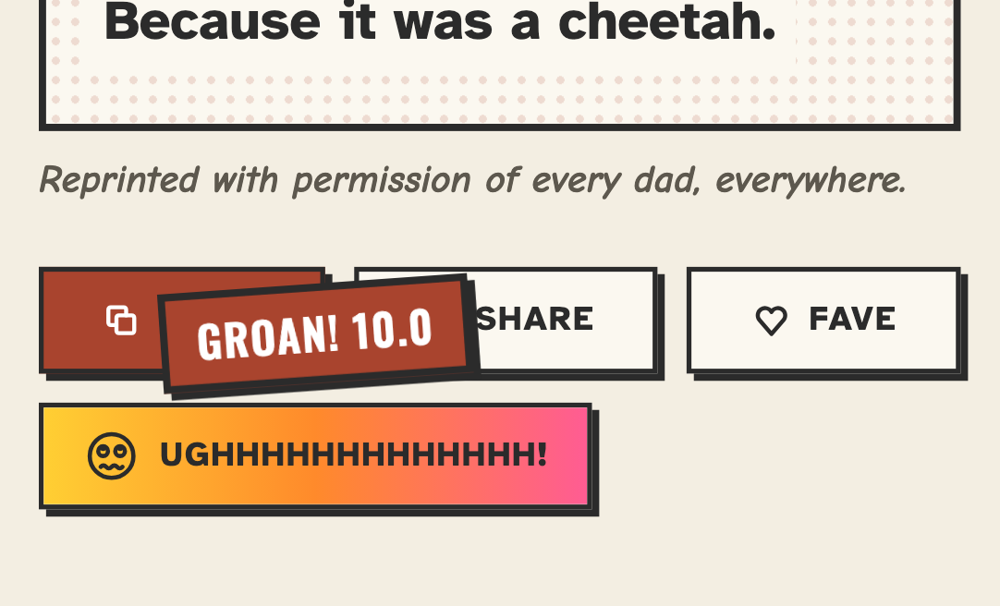   | 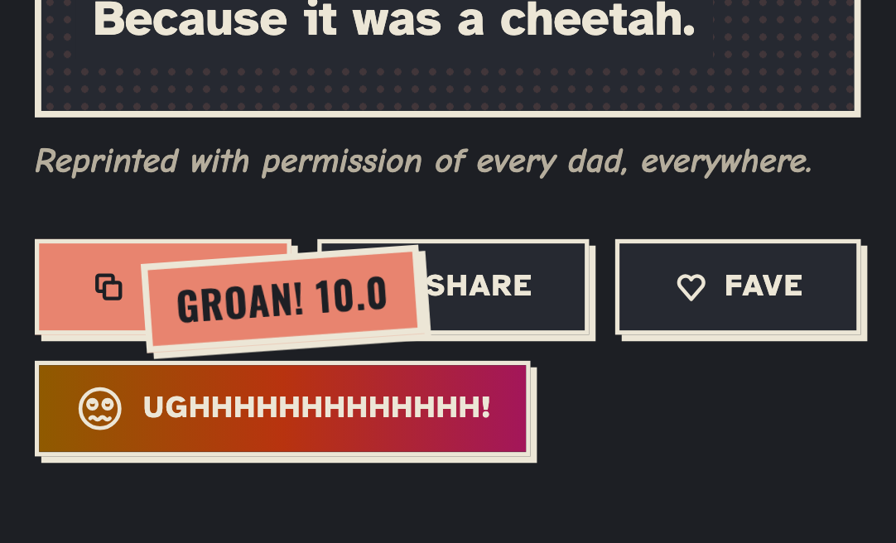   |
| After: the "Ughhh" stays     | 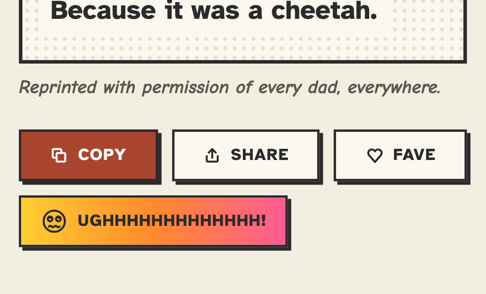   | 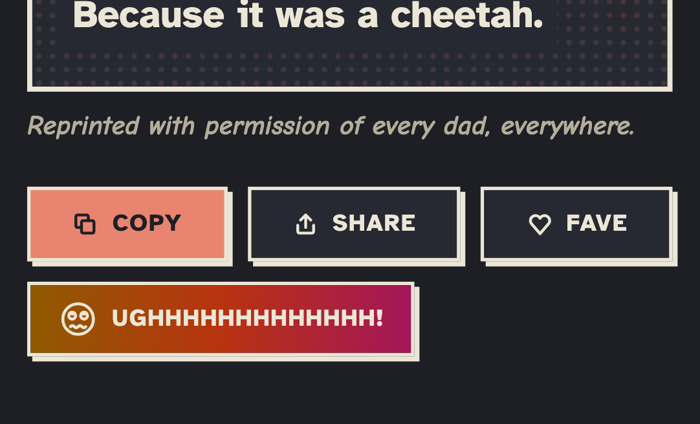   |
| The Groan Leaderboard, phone | 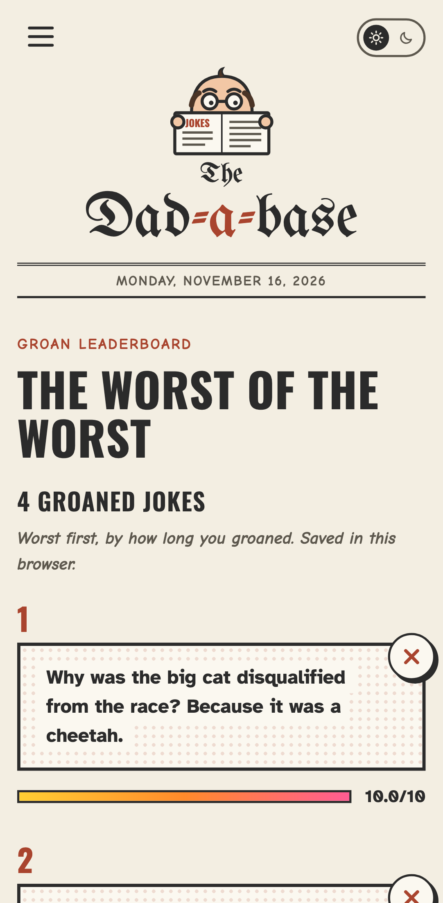    | 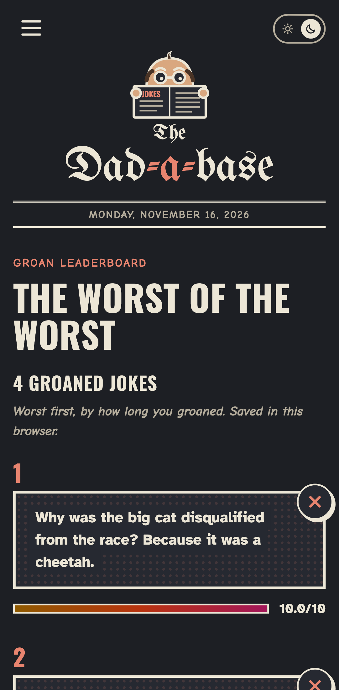    |

| Screen                              | Shot                                                    |
| ----------------------------------- | ------------------------------------------------------- |
| Desktop, a 7.2 Groan                | 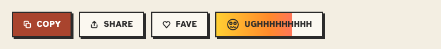       |
| Desktop, its tooltip                | 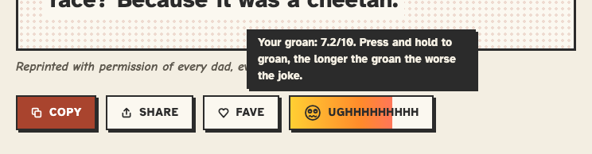 |
| The Groan Leaderboard, desktop      | 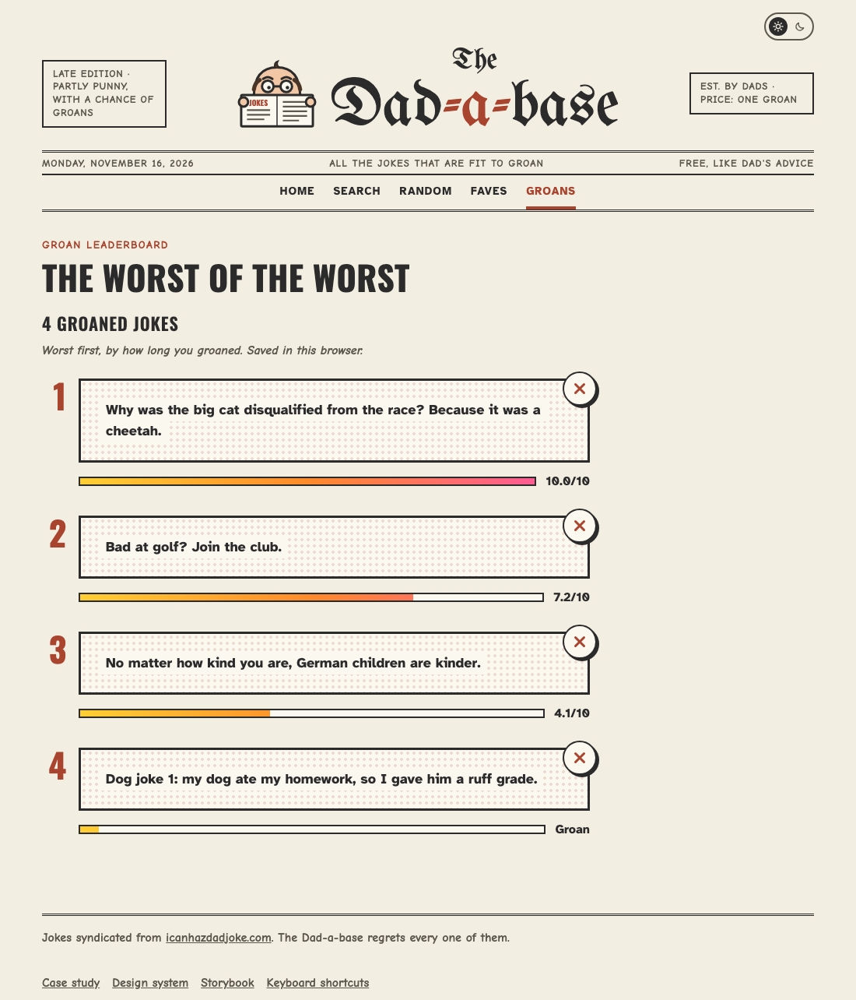          |
| The Groan Leaderboard, empty, phone | 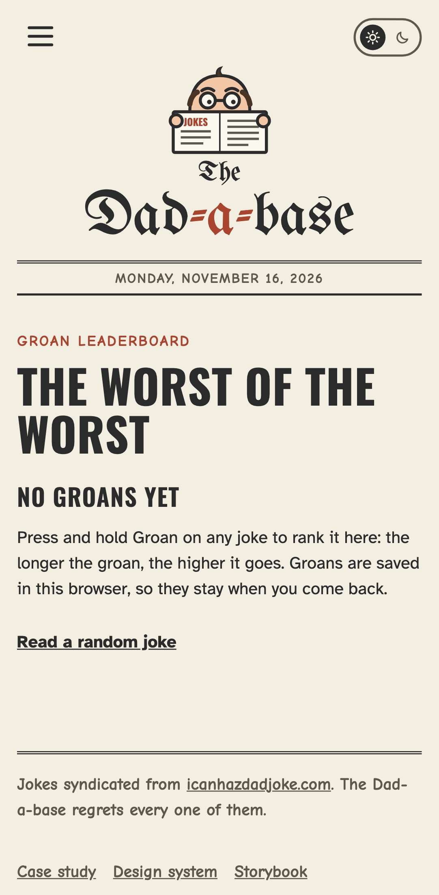      |

## Decisions

### Settled in the grilling

- **Personal, never global.** Groans are saved in this browser, like Favorites. A shared board needs a backend and, with no accounts, would be a board of whoever held longest. There will never be one.
- **"No ratings" is amended, not broken quietly.** The spec now says "no invented ratings: the only score is the Visitor's own Groan". The glossary has **Groan**, **Groan score** and **Groan Leaderboard**, and the Case Study owns the reversal.
- **Where:** beside "Another" on home and `/random`, and last in a Joke's actions. Not on Search or Favorites cards, which are links in their entirety, so a hold there would mean a control inside a link and accidental Groans while scrolling.
- **The score:** the fraction of 3 seconds held, filled linearly, stored precisely so ties are rare, and shown out of 10 to a tenth (1.0–10.0). A hold under 300ms was a tap: still a Groan, shown as "Groan". (Changed after the phone test, below.)
- **A new Groan replaces the last,** so a slip can be corrected and holding longer doesn't add up.
- **Recorded on release,** however short. At full it shakes until let go. Sliding off, a scroll taking over, or Escape cancels, and the fill drains.
- **Keyboard:** Space and Enter hold it like a pointer, and a held key's repeats are ignored. The result is announced once through the toast region: "Groan score 7.2 out of 10."
- **The payoff:** a comic "GROAN! 7.2" burst, haptics where the browser has them, no sound. Under reduced motion the fill and label still change, but nothing shakes, nudges or flies.
- **The leaderboard:** worst first, newest first on a tie; a big rank, the Joke card, a bar in the button's gradient with "7.2/10", and Remove on the corner; ten a page with `?page`; an empty state linking to Random.
- **No keyboard shortcut.** Holding a key anywhere on the page to score something would surprise, and the focused button already takes Space and Enter.
- **The Sections menu came first,** in its own pull request (journal 0010), since a fifth section didn't fit the phone's header.

### Asked for while building

The author tried the button running and asked for these.

- **A groaning face** on the button: eyes rolled up, mouth a wobble.
- **A bolder gradient,** in three stops: sunshine to tangerine to hot pink in light, and amber to burnt orange to magenta in dark.
- **The hover hint is a nudge,** not a slow pulse: the fill jumps a quarter of the way and back as the button bumps, then rests, every 1.8 seconds, until the pointer leaves or presses.
- **The label gains an h steadily:** "Ugh", then another h every quarter second, up to 12, and a "!" when it's full. It replaced four tiers ("Groan", "Ugh…", "Ughhh…", "UGH!").
- **The "Ughhh" stays after it's let go,** and comes back on later visits from the stored score: a 7.2 is "Ugh" and eight h's.
- **The button is as wide as its label,** growing as it's held, rather than wide enough for the longest label from the start (about 18rem).
- **No line on the fill's leading edge.** See the contrast note below.
- **Shorter labels:** "Another one" is now "Another", "Favorite" and "Favorited" are "Fave" and "Faved", and the navigation's "Favorites" is "Faves". The `/favorites` route, the page's own headline and the glossary's **Favorite** stay.
- **A cross for Remove on the leaderboard,** not the Favorites page's broken heart.
- **The same fall on Remove as on Faves:** the card drops, tilts and fades while the ones below slide up.
- **The tooltip reads** "Press and hold to groan, the longer the groan the worse the joke."

### Asked for after testing on an iPhone

The author tried a preview deploy on an iPhone, and found it clunky.

- **Only a long press groans.** A tap started a hold that then ran until the next tap. Now a hold begins only once a press passes 300ms, counted from the press, so every Groan is 1.0–10.0. A shorter press records nothing and shows the tooltip for 2.5 seconds, since a phone has no hover to show it. This reverses the grilling's "a tap still counts". The leaderboard still shows a tap saved before as "Groan".
- **The lift is heard anywhere.** Safari on iOS didn't always send the button its own `pointerup`, so the hold never heard the finger lift. While pressed, the button now listens on the whole window, for `pointerup` and `touchend`, and `pointercancel` and `touchcancel` cancel.
- **Groan wraps only when it must.** It keeps room for its widest label, "Ughhhhhhhhhhhhh!" with the face (`--groan-room`, 18rem), so it shares the line with the other buttons when that fits, as on desktop, and wraps to its own when it doesn't, as on a phone. It sits at its own width in that room, so it never moves while held. On a line too narrow even for that, at 320px and 200% zoom, it shrinks rather than overflows. Before, on a phone it stretched across a row like the others, and for a while it always took a line of its own.
- **Only the button nudges.** With room kept beside it, hovering that empty room set off the nudge and the tooltip. Now the nudge follows a hover over the button, and the tooltip a hover over the button or the tooltip itself.

### Defaults, not asked

- **The name follows the label (WCAG 2.5.3).** The plan kept the name "Groan" throughout, but axe flagged the button reading "Ugh…" with a different name. Now it's "Groan" at rest and "Groan: Ughhh" once it isn't, from one visually hidden span, with the visible label hidden from assistive tech. The words you see are in the name, and speech input can still say "Groan".
- **The tooltip and the burst sit beside the button, not in it,** so they aren't part of its name. The tooltip is its description.
- **It holds on to the pointer while held.** Growing with its label, the button can wrap onto the next line mid-hold, which looked like the pointer leaving. Now it captures the pointer, and only moving more than 44px (a touch target) from where it pressed cancels.
- **The fill is a registered custom property (`--groan-level`),** so it drains back smoothly and the nudge can animate it. The gradient spans the whole button and the fill is clipped, so it warms as it reaches further.
- **Contrast, by the numbers.** The label stays the text colour, and a token test samples 21 points along each half of the gradient: the worst is 4.86:1 in light and 4.64:1 in dark. Without its edge line, the fill is under 3:1 against the empty button. It's a second cue, not the only one: the growing "Ughhh" and the announced score say the same.
- **The tooltip is out of the layout when hidden** (`display: none`, fading with `allow-discrete`). Invisible but laid out, near a phone's edge it made the page scroll sideways at 320px.
- **It shakes only while held.** It first kept shaking after a full hold was let go, since the stored score was still full.
- **The store is Favorites' shape:** whole Jokes with `score` and `groanedAt`, validated with Zod, in step across tabs, and fine when storage is blocked. The Jokes go in Apollo's cache, so opening one from the board makes no request.
- **Remove is the Favorites button,** given a `label` and an `icon` prop, rather than a copy.
- **On a phone, the rank sits above its card,** so the Joke keeps the width.

## Problems found on the way

- **Storybook can't hover.** Its simulated hover doesn't trigger CSS `:hover`, so the story shows the tooltip on keyboard focus, and Playwright tests the real hover and its nudge.
- **The emulated iPhone sends nothing for Playwright's mouse,** and Playwright has no long press, so on that project the tests send touch pointer events to the button. A real finger is the author's check on a real iPhone.
- **A locator that waited forever.** Tests found the button by the name "Groan", which changes the moment a hold starts, so the release never found it. They now match the name's start.
- **Vue's scoped keyframes have a hash** (`nudge-bump-eb73b51e`), so the nudge test matches the name's start.
- **The accessible name lost a space.** "Groan: " in its own span came out as "Groan:Ughhh", since each piece is trimmed. The whole name is now one span.
- **A test sampled a quarter-second boundary,** where a frame can land just short, and saw one h too few. It samples between boundaries now.

## Tests

- **Vitest:** the score rules; the hold, with fake timers (waiting past a tap, fill, full, a tap recording nothing, cancel, key repeats, scope end); the store (record, replace, rank, remove, saved, invalid, other tabs, blocked storage); the button's wiring (pointer, keys, slide-off, cancel, a lift heard anywhere, a tap's hint, the name, the tooltip, the burst); the leaderboard (empty, ranking, a tap, Remove and focus, pages); the Case Study's live button; and the gradient's contrast.
- **Storybook:** GroanButton's `Idle`, `Focused`, `Holding`, `Full`, `Groaned` and `Tap`; the Remove button's `Groan`.
- **Playwright:**
  - a hold on a Joke's page records, announces and is remembered; it's on home and Random; sliding off records nothing; Space holds it;
  - with a mouse: the nudge and tooltip, and none once groaned; full shakes and records 10.0; reduced motion has no nudge or shake but still fills;
  - axe mid-hold and after, in both themes;
  - the leaderboard: a Groan goes on it and opens from it; Remove down to the empty state; the fall, and none under reduced motion; axe in both themes; 320px with 44px targets; and `/groans` in the full-site axe and reflow checks.
- **Totals:**
  - Vitest and Storybook: 364 passed, 97.1% of statements and 93.2% of branches.
  - Playwright: 361 passed, 23 skipped (the mouse-only tests on phones, and those already skipped on WebKit).

## VoiceOver pass

**Status: passed.** The author ran this pass on 2026-11-16, on an iPhone, over the Groan button and the Groan Leaderboard.

The author also held the button with a real finger on an iPhone, on a preview deploy, after the long-press changes: the one path the tests can't drive. It works.

## Deployed

In production at <https://the-dad-a-base.vercel.app> since 2026-11-16, from `master` at `5701402`, with the Sections menu before it (journal 0010) and the refactor after it (journal 0012).
